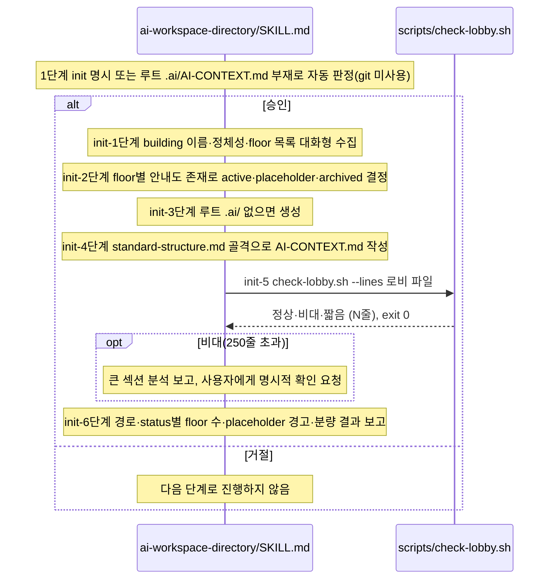

# ai-workspace-directory init 호출 흐름

## What

멀티 repo 워크스페이스 루트에 로비 `.ai/AI-CONTEXT.md`(라우터)를 새로 작성한다. 도메인 본문 없이 `Repos` 표와 진입 절차 같은 라우팅·포인터만 담는다.

## How

```
ai-workspace-directory/SKILL.md
├── 1단계: 모드 결정                  # <루트>/.ai/AI-CONTEXT.md 존재로 자동 판정, 사용자 확인 없이는 진행 금지, git 미사용
├── init-1단계: 입력 수집             # 대화형, references/examples.md
├── init-2단계: 디스크 스캔           # floor 별 status 결정
├── init-3단계: .ai/ 디렉토리 준비
├── init-4단계: AI-CONTEXT.md 작성    # references/standard-structure.md 의 표준 6개 H2, 2번째 줄은 repo 안내도 선언을 따른다는 고정 문구, 진입 절차의 placeholder 분기는 소스 코드 폴백
├── init-5단계: 분량 가드레일         # scripts/check-lobby.sh --lines <파일>: "<판정> (<줄 수>줄)" 출력, 150~250줄 권고, exit 0. 250줄 초과(비대)는 사용자에게 명시적 확인 요청
└── init-6단계: 보고
```

### 시퀀스 다이어그램



## Why

- 설계 근거는 `ai-workspace-directory/SKILL.md` `### 산출물의 본질`(라우팅·색인만), `### 대전제 (절대 위배 금지)`(각 repo의 SSoT는 그 repo 안내도의 선언이 정하고 로비는 SSoT 값을 선언하지 않음, 우선순위 각 repo의 SSoT > repo 안내도 > 로비, CoC·YAGNI), `### 파일 경로 규약`에 있다.
- repo 쪽 `## 프로젝트 도메인` 표와 로비 `Repos` 행의 1:1 동기화는 `## 관련 skill`에 있다. 역참조는 CoC로 대신한다.
- 명세: [.ai 작업공간과 안내도 요건](../../40_domain/specs/ai-workspace.md)(모드 자동 판정, 표준 섹션 구조·분량 가드레일, git 미의존).
- 정책: [SSoT 원칙과 안내도 라우터](../../40_domain/policies/local/ssot-and-router-principle.md)(로비는 라우터, 150~250줄, 판정 결과를 git 추적 파일에 기재하지 않음).
- 로비가 SSoT 값을 선언하지 않고 repo 안내도의 선언을 따르는 결정은 [ADR 0020](../../50_adr/active/0020-doc-ssot-original-documents-and-publishing-deferred.md).
- 헬퍼·테스트 배치는 [ADR 0001](../../50_adr/active/0001-skill-deterministic-helper-test-convention.md).
