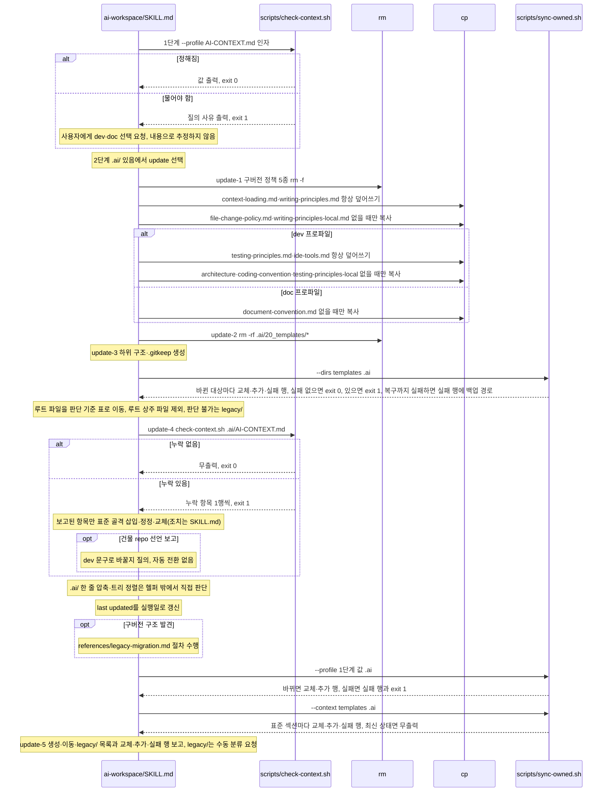

# ai-workspace update 호출 흐름

## What

기존 `.ai/`를 보존하면서 규칙 파일·디렉토리 골격·`AI-CONTEXT.md`를 최신 구조로 맞춘다. 스킬이 소유한 원장 템플릿, index 고정 구간, 안내도 표준 섹션은 템플릿 최신본으로 바꾸고, 사용자 작성 파일은 없을 때만 빈 템플릿을 복사한다.

## How

```
ai-workspace/SKILL.md
├── 1단계: 프로파일 확인
│   └── scripts/check-context.sh --profile <AI-CONTEXT.md> [dev|doc]   # 값 출력·exit 0, 물어야 하면 `질의:` 사유·exit 1이라 사용자 선택, exit 2면 중단. 파일 변경 없음
├── 2단계: 모드 결정                    # .ai/ 있음에서 update 선택
├── update-1단계: 10_rules/ 정리
│   ├── rm -f 구버전 정책 5종           # git-commit-policy·git-pr-policy·git-review-policy·git-review-context-builder·issue-workflow
│   ├── cp context-loading.md·writing-principles.md   # 버전 고정, 항상 덮어쓰기. dev면 testing-principles.md·ide-tools.md도
│   └── 없을 때만 cp                    # file-change-policy·writing-principles-local, dev면 architecture·coding-convention·testing-principles-local, doc면 document-convention
├── update-2단계: 20_templates/ 정리    # rm -rf .ai/20_templates/* (issue-work로 이관된 구 템플릿 제거)
├── update-3단계: 콘텐츠 디렉토리 정비   # 30_contract~90_issues 하위 구조·.gitkeep
│   ├── scripts/sync-owned.sh --dirs <templates> .ai   # 없을 때만 복사(index.md·40_domain/glossary.md), 항상 최신본(ledger-entry-template.md), 구간 교체(50_adr/index.md `## 수명 주기`, 70_ledger/index.md 머리말·`## 수명 주기`). exit 1이면 계속하고 `실패:` 행을 update-5에 싣는다(실패한 파일은 변경 전 내용 유지, 복구까지 실패하면 행에 백업 경로), exit 2면 이 호출 중단·보고
│   └── 루트 파일 이동                  # 판단 기준 표(ADR 상태 줄·원장 상태 값)로 specs·policies/local·active·superseded·archive, 불가면 legacy/. 루트 상주 파일(index.md·40_domain/glossary.md·ledger-entry-template.md)은 제외
├── update-4단계: AI-CONTEXT.md 갱신
│   ├── scripts/check-context.sh <AI-CONTEXT.md>   # 12항목 판정, 누락 1행씩·exit 1, 조치는 SKILL.md
│   │   ├── SSoT 선언 행                # dev·doc 두 표준 문구 인정, doc 선언이면 ssot_dir 행·dev 표준 문구 4곳(우선순위·60_codebase 설명 3곳) 잔존도 검사. doc 문구를 넣은 실행은 ssot_dir 자리표시자 행 보강, dev 문구를 넣은 실행은 testing-principles.md·ide-tools.md 행 중 없는 행 보강(헬퍼 1회 실행이라 같은 실행에서 재검사 없음). 4곳은 아래 표준 구간 최신화가 교체. 건물 repo면 프로파일과 무관하게 dev 문구로 삽입·교체
│   │   ├── 건물 repo 선언 행           # 같은 .ai/ 아래 60_codebase/repository.yaml 존재 + doc 표준 문구면 보고, dev 문구로 바꿀지 질의(자동 전환 없음). 승인 시 testing-principles.md·ide-tools.md 행 중 없는 행 보강, 4곳은 아래 표준 구간 최신화가 dev 템플릿으로 교체
│   │   ├── profile 행                  # 첫 표에 정확히 한 행, 값 dev·doc. SSoT 선언과 대조 없음. 조치는 아래 --profile
│   │   ├── 프로젝트 규칙 섹션·표        # 없으면 선택한 프로파일 템플릿 골격으로 복구. 복구한 실행은 본문 2번째 줄이 dev 표준 문구면 프로파일과 무관하게 testing-principles.md·ide-tools.md 행 중 없는 행을 표 끝에 삽입
│   │   └── testing-principles.md·ide-tools.md 행   # 본문 2번째 줄이 dev 표준 문구일 때만 검사(doc·비표준 선언은 미검사), 없으면 표 끝에 표준 행 삽입
│   ├── .ai/ 한 줄 압축·트리 정렬 판단   # 헬퍼 밖 2항목, 트리 구조 해석
│   ├── last updated 를 실행일로 갱신
│   ├── references/legacy-migration.md  # 구버전 구조 발견 시에만
│   └── 표준 구간 최신화                # 위 조치와 마이그레이션 뒤. exit 처리는 update-3 호출과 같음
│       ├── scripts/sync-owned.sh --profile <1단계 값> .ai   # 첫 표의 profile 행을 그 값의 한 행으로. 행 없으면 표 끝에 추가, 둘 이상이면 한 행으로 정리
│       └── scripts/sync-owned.sh --context <templates> .ai  # 표준 섹션 4개를 SSoT 선언에 맞는 템플릿으로 교체(profile 값과 무관), 없으면 파일 끝에 추가, 템플릿에 없는 ### 소제목 유지. 비표준 선언은 실패
└── update-5단계: 완료 보고             # 생성·이동·legacy/ 목록, 헬퍼의 `교체:`·`추가:`·`실패:` 행, legacy/ 는 수동 분류 요청
```

### 시퀀스 다이어그램



## Why

- 설계 근거는 `ai-workspace/SKILL.md` `### 설계 원칙`과 `## 디렉토리 트리 정렬 규칙`에 있다. 버전 고정 파일과 사용자 관리 파일을 나눈 이유는 update-1단계 주석에 있다.
- `check-context.sh`가 판정만 맡고 조치를 SKILL.md에 남긴 것은 [architecture.md 디자인 원칙](../../10_rules/architecture.md)의 역할 분담을 따른 것이다. 헬퍼·테스트 배치는 [ADR 0001](../../50_adr/active/0001-skill-deterministic-helper-test-convention.md).
- 원장 [K-0001](../../70_ledger/archive/K-0001-update3-fixture-absent.md): update-3 파일 정리에 회귀 fixture가 없었다(해소(PR #124)).
- 원장 [K-0018](../../70_ledger/active/K-0018-update4-rules-restore-profile-mismatch-row.md): update-4에서 `## 프로젝트 규칙` 섹션·표를 프로파일이 어긋난 템플릿으로 복구하면 그 실행에서 `testing-principles.md` 행이 빠졌다. #136에서 섹션·표를 복구한 실행이 dev 표준 선언이면 dev 행 2개를 함께 넣도록 바뀌어 원인이 사라졌다.
- update-3 `50_adr/` 판정을 본문 키워드 대신 상태 줄 값으로 하고 상태 줄 없는 ADR을 `active/`로 두는 결정은 [ADR 0022](../../50_adr/active/0022-adr-lifecycle-status-and-superseded-move.md). 판단 기준 표 5행·루트 상주 파일·`legacy/`는 회귀 fixture `ai-workspace/tests/fixtures/update3-file-cleanup/`(모의 실행 `[QD]`)가 덮으며, 이 fixture로 원장 K-0001을 해소했다.
- 명세: [.ai 작업공간과 안내도 요건](../../40_domain/specs/ai-workspace.md)(update 소유 구분·구조 정합, 멱등 보강 검사 12종 + AI 판정 2종, 프로파일 결정, 표준 구간 최신화, 루트 상주 파일 제외).
- 소유 구분(파일 단위 최신본·구간 단위 교체·사용자 작성), `sync-owned.sh` 분리, 표준 섹션 템플릿을 SSoT 선언으로 고르는 규칙, `profile` 행과 1단계 결정 규칙은 [ADR 0028](../../50_adr/active/0028-ai-workspace-owned-sections-and-profile-row.md). `## Git 정책` 표는 이 교체로 최신본이 되어 #70 리스크가 해소됐다.
- 정책: [SSoT 원칙과 안내도 라우터](../../40_domain/policies/local/ssot-and-router-principle.md).
- 버전 고정 파일(`context-loading.md`·`writing-principles.md`)을 항상 덮어쓰고 AI-CONTEXT 규칙 표 행을 멱등 보강으로 전파하는 결정은 [ADR 0008](../../50_adr/active/0008-writing-principles-ssot-distribution.md). `70_ledger/` 신규 디렉토리·골격 index 전파는 [ADR 0007](../../50_adr/active/0007-tech-debt-ledger-location-and-structure.md). 트리 해석 2종을 헬퍼 밖에 둔 판단은 [ADR 0003](../../50_adr/active/0003-verification-levels-and-determinization.md) 대안 절(#90 당시 10종 중 8종). 건물 repo 선언 검사와 doc 전용 `document-convention.md`는 [ADR 0020](../../50_adr/active/0020-doc-ssot-original-documents-and-publishing-deferred.md). dev 전용 `testing-principles.md`(버전 고정)·`testing-principles-local.md`(사용자 관리) 쌍과 dev 표준 선언 한정 `testing-principles.md` 행 검사는 [ADR 0023](../../50_adr/active/0023-testing-principles-pair-and-consumer-skill-references.md). dev 전용 `ide-tools.md`(버전 고정)의 update-1 덮어쓰기, dev 표준 선언 한정 `ide-tools.md` 행 검사, 규칙 섹션·표 복구와 선언 보정 실행의 dev 행 보강은 [ADR 0029](../../50_adr/active/0029-ide-tools-rule-dev-profile-distribution.md).
