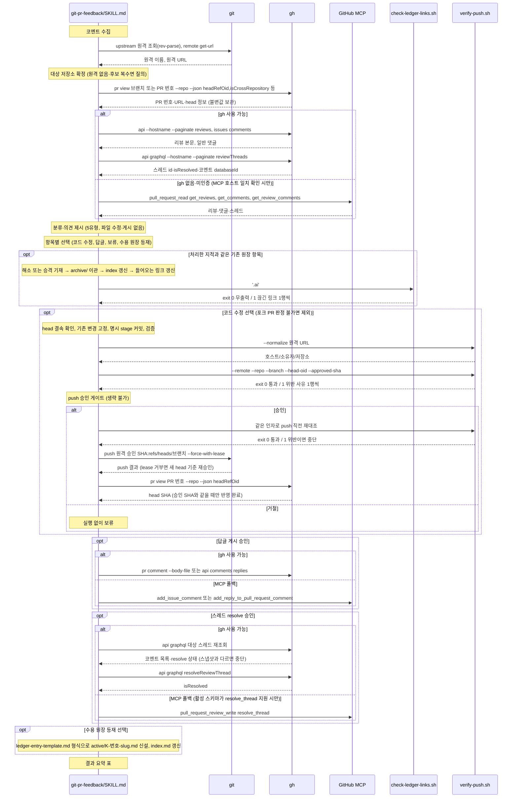

# git-pr-feedback 대응 호출 흐름

## What

PR 리뷰 코멘트를 수집·분류해 항목별 의견을 내고, 사용자 선택에 따라 답글 게시·코드 수정·스레드 resolve·원장 등재로 대응한다. 외부 공개 행위는 승인 게이트를 지난다.

## How

```
git-pr-feedback/SKILL.md
├── 코멘트 수집
│   ├── 대상 PR 식별      # git rev-parse @{upstream}, git remote get-url, gh pr view --repo --json …headRefOid,isCrossRepository (불변값 보관)
│   ├── gh api --paginate reviews·comments, gh api graphql --paginate reviewThreads
│   └── 폴백: GitHub MCP pull_request_read
├── 분류·의견 제시        # 5유형(조치 필요·불필요·수용·코멘트로 충분·확인 필요), 파일 수정·게시 금지
├── 사용자 선택·승인 게이트 (생략 불가)
│   ├── 항목별 선택        # 코드 수정 / 답글 / 보류 / 수용(원장 등재), 등재·코드 수정 선택 시 .ai/70_ledger/index.md 대조
│   └── 기존 원장 항목 종결   # 처리 방식과 무관, 원인이 사라지면 해소(PR #<번호>)·별도 이슈면 승격(이슈 #<번호>) → archive/ → index 갱신
│       └── 들어오는 링크 갱신   # archive/로 옮긴 항목을 가리키는 .ai/ 링크(같은 디렉토리 원장 링크 포함, 90_issues/archive/ 제외)를 새 경로로
│           └── scripts/check-ledger-links.sh '.ai'   # 끊긴 원장 링크 1행씩·exit 1, 이동과 무관한 기존 끊김은 목록으로 알리고 질의
├── 조치 실행
│   ├── 코드 수정          # head 결속 확인(headRefName·headRefOid), git status --porcelain 고정, 포크 PR 판정 불가면 제외, 명시 stage 커밋·검증
│   │   ├── scripts/verify-push.sh --normalize <URL>
│   │   ├── scripts/verify-push.sh --remote --repo --branch --head-oid --approved-sha   # 승인 전 확인과 push 직전 재대조, fetch·push URL 1개·원격 ref·조상 관계, exit 0/1/2
│   │   ├── git push --force-with-lease   # 승인 SHA·대상 브랜치 refspec 고정, lease 기대값은 보관한 headRefOid
│   │   └── gh pr view --json headRefOid  # 승인 SHA와 일치할 때만 반영 완료
│   ├── 답글 게시          # gh pr comment --body-file / gh api …/comments/<id>/replies (폴백 MCP add_issue_comment·add_reply_to_pull_request_comment)
│   ├── 스레드 resolve     # 직전 재조회로 스냅샷 대조 후 gh api graphql resolveReviewThread (폴백 MCP pull_request_review_write resolve_thread, 스키마 지원 시만)
│   └── 원장 등재          # .ai/70_ledger/ledger-entry-template.md → active/K-<번호>-<slug>.md, index.md 갱신
└── 결과 요약              # 항목·분류·사용자 선택·결과 표, 수용 항목은 K 번호, 미등재·resolve 미지원·push 미포함 변경 명시
```

### 시퀀스 다이어그램



## Why

- 근거는 `git-pr-feedback/SKILL.md` `### 대상 PR 식별`(최초 조회부터 `--repo`·`--hostname` 명시), `### 항목별 선택`(등재 없는 수용은 추적처가 없다, 중복 등재 금지), `### 기존 원장 항목의 종결`, `### 승인 게이트 (생략 불가)`, `### 코드 수정`(포크 PR 제외, `git add -A` 금지, pushurl 복수 위험)에 있다.
- 원장 형식은 ai-workspace가 배포하는 `.ai/70_ledger/ledger-entry-template.md`이며 issue-work `--response`와 공유한다. 등재 주체가 둘이라 어느 스킬에도 두지 않는다(ai-workspace SKILL.md `## 이 구조와 함께 사용 가능한 skill`).
- 계약: [GitHub 연동 수단](../../30_contract/github-integration.md)(gh 기본·MCP 폴백, `--repo`·`--hostname`, resolve 스키마 필수 입력, push URL 1개 규칙). 명세: [PR 리뷰 코멘트 대응 요건](../../40_domain/specs/git-pr-feedback.md).
- 정책: [외부 공개 행위 승인 게이트](../../40_domain/policies/local/external-action-approval-gate.md)(답글·resolve·push 승인, 승인 값 불변 보관·재대조, userinfo 제거). 별도 스킬로 둔 결정과 의견 유형 5종은 [ADR 0012](../../50_adr/active/0012-git-pr-feedback-separate-skill.md).
- 원장 등재·종결 규칙과 소비자 상태 행렬은 [ADR 0007](../../50_adr/active/0007-tech-debt-ledger-location-and-structure.md). 종결로 옮긴 뒤 들어오는 링크 갱신과 끊긴 원장 링크 검사 헬퍼는 [ADR 0021](../../50_adr/active/0021-ledger-archive-move-link-update.md).
- 헬퍼·테스트 배치는 [ADR 0001](../../50_adr/active/0001-skill-deterministic-helper-test-convention.md).
