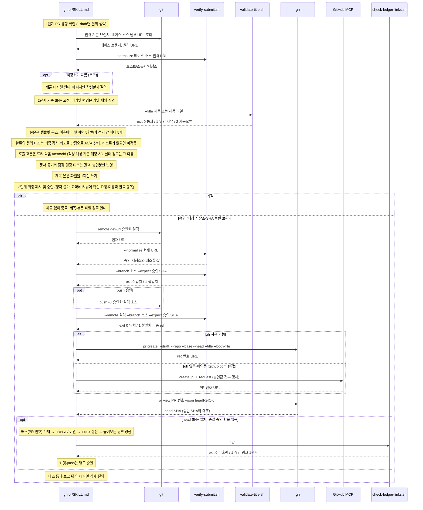

# git-pr 제출 호출 흐름

## What

PR 제목·본문을 파일로 쓰고, 유형 확인과 승인 게이트를 거쳐 push·PR 생성까지 한다. 승인받은 저장소·SHA를 불변값으로 보관해 생성 직전마다 재확인한다.

## How

```
git-pr/SKILL.md `## PR 제출`
├── 1. PR 유형 확인                     # 정식 기본, 기본값도 확인 응답 필수 (--draft 면 이 질의만 생략)
│   ├── 베이스 브랜치 자동 감지         # 원격 기본 브랜치
│   └── scripts/verify-submit.sh --normalize <URL>   # 베이스·소스 저장소 대조, 포크면 제출 미지원 (메시지만 작성 여부 질의)
├── 2. 메시지 작성                      # 기준 SHA 고정, 미커밋 변경 있으면 커밋·제외 질의, 이후 PR 제목 → PR 메시지 구조 → 문서 동기화 점검 순
│   ├── scripts/validate-title.sh --title '<제목>' | <제목 파일>   # exit 0/1/2
│   ├── templates/pr-body-template.md   # 이슈 목록 → 이슈별 첫 화면 5항목(접기 밖, 없으면 `없음`) + 접기 안 헤더 5개(없으면 `없음`)
│   │   ├── 첫 화면                     # 목적·범위 → 리뷰어 확인 요청(질문) → 리스크·주의사항 → 완료의 정의 대조(`충족 n/m (충족 아닌 AC와 상태)`) → 이번 PR에서 하지 않는 것
│   │   ├── 완료의 정의 대조            # 최종 감사 리포트 `### 완료의 정의(DoD) 대조` 표(--clear 전 99_workspace, 뒤 90_issues/archive/issue-<번호>/)를 spec 항목과 R 그룹·순서로 맞추고 출처 `(AC<n>)`로 AC 연결, 상태 5종을 이관 → 미검증 → 미충족 → 충족 → 부분 충족 순으로 판정, spec 체크박스는 근거로 안 씀, `(AC 없음: …)`는 R 그룹 단위로 따로 표시
│   │   ├── 접기 안                     # 완료의 정의 대조 표(`| AC | 상태 | 근거 |`) → 전후 예시(동작 차이 없으면 `없음`) → 배경 → 1. 비즈니스 관점 → 2. 테크 관점
│   │   └── 테크 관점                   # 구현 요약 → 호출 흐름 → 실패 경로(없으면 `없음`) → 참고사항
│   │       └── 호출 흐름               # 색인 대신 SSoT 직접 확인(AI-CONTEXT 선언, 선언이 없으면 소스 코드로 보고 AI-CONTEXT가 있을 때만 1줄 알림), 기능별 트리 → 작성 대상 기준 3행 해당 시 바로 다음 mermaid (소제목 없음, `## 시퀀스 다이어그램 작성 규칙`)
│   ├── 문서 동기화 점검                # README·AI-CONTEXT·60_codebase 갱신 권고만, 실행 여부 질의
│   │   └── 원장 대조                   # .ai/70_ledger/index.md active/ 항목의 재검토 조건·원인 vs diff → 재검토 이력·종결 권고, 승인분만 반영, 해소는 4단계로
│   │       └── 승격 이관               # 이슈 생성 별도 승인 → 승격(이슈 #N) → archive/ → index 항목 목록 → 4단계 원장 해소 기재의 들어오는 링크 갱신
│   └── 산출: .ai/99_workspace/pr-<이슈>-title.md·pr-<이슈>-body.md   # 1회만 쓰고 이후 파일 참조
├── 3. 최종 제시 및 승인 (생략 불가)     # 제목 전문, 본문 경로+요약(이슈 목록·리뷰어 확인 요청·리스크·미충족 완료 항목·결정사항), 대상 저장소·베이스·소스·SHA·동기화 상태·유형, push 여부·원격
└── 4. PR 생성
    ├── verify-submit.sh --normalize "$(git remote get-url <원격>)"   # 승인 저장소와 동일할 때만
    ├── verify-submit.sh --branch <소스> --expect <SHA>              # 로컬 head 재확인
    ├── git push -u <원격> <소스>                                     # 승인받은 경우만
    ├── verify-submit.sh --remote <원격> --branch <소스> --expect <SHA>   # ls-remote 완전 ref 1행·SHA 일치
    ├── gh pr create [--draft] --repo --base --head --title "$(cat …)" --body-file   # 확인과 생성 사이에 다른 동작 금지
    │   └── 폴백: GitHub MCP create_pull_request (github.com 한정, 승인값 전부 명시)
    ├── gh pr view <번호> --json headRefOid                            # 생성 후 승인 SHA 대조
    ├── 원장 해소 기재                                                  # 종결 승인 항목만: 해소(PR #<번호>) → archive/ → index → 들어오는 링크 갱신, 커밋·push 별도 승인
    │   └── 들어오는 링크 갱신                                          # index 갱신 뒤·커밋과 push 앞, 옮긴 항목을 가리키는 .ai/ 링크(같은 디렉토리 원장 링크 포함, 90_issues/archive/ 제외)를 새 경로로
    │       └── scripts/check-ledger-links.sh '.ai'                     # 끊긴 원장 링크 1행씩·exit 1, 이동과 무관한 기존 끊김은 목록으로 알리고 질의
    └── 임시 파일 삭제 질의                                            # 대조 통과·보고 뒤에만
```

### 시퀀스 다이어그램



생략한 호출은 위 트리에서 확인한다.

## Why

- 각 가드의 근거는 `git-pr/SKILL.md` `## PR 제출` 1~4단계 본문에 작성자가 기재했다. 포크 미지원, 승인값 불변 보관, 원격 이름은 가변 별칭이라 URL 재정규화, `ls-remote` tail 패턴 위험, `--repo`·`--head` 생략 금지, 승인값 셸 보간 금지가 그것이다.
- 제목이 Conventional Commits를 따르는 이유는 `## PR 제목`(Squash Merge 시 커밋 메시지가 됨).
- 원장 [K-0003](../../70_ledger/active/K-0003-approved-file-content-unverified.md): 승인한 제목·본문 파일의 내용 동일성은 제출 직전에 검증하지 않는다(수용).
- 첫 화면 5항목과 접기 안 구성, 완료의 정의 대조를 최종 감사 리포트 판정으로 정하고 spec 체크박스를 쓰지 않는 이유, 승인 요약에 미충족 완료 항목을 더한 결정은 [ADR 0026](../../50_adr/active/0026-acceptance-criteria-across-issue-spec-pr.md). PR 이해를 돕는 수단 가운데 보류한 것은 원장 [K-0020](../../70_ledger/active/K-0020-quiz-link-to-pr-and-task-deferred.md)(퀴즈 연결)·[K-0021](../../70_ledger/active/K-0021-microworld-generation-deferred.md)(마이크로월드)·[K-0022](../../70_ledger/active/K-0022-doc-profile-flow-substitute-format-deferred.md)(doc 저장소의 호출 흐름 대체 형식).
- 정책: [외부 공개 행위 승인 게이트](../../40_domain/policies/local/external-action-approval-gate.md)(git-pr·git-pr-feedback·git-review-quiz·issue-work --clear 공통). 제출까지 확장한 결정과 유형 확인·승인 게이트 필수화는 [ADR 0011](../../50_adr/active/0011-git-pr-submission-and-approval-gate.md).
- 계약: [GitHub 연동 수단](../../30_contract/github-integration.md)(gh 기본·MCP 폴백 github.com 한정, `refs/heads/` 완전 ref, 동적 인자 인용). 명세: [PR 제출 요건](../../40_domain/specs/git-pr-submission.md)(절차, 문서 동기화 점검 표).
- 원장 대조와 PR 생성 후 해소 기재(PR 번호를 알 때만 확정)는 [ADR 0018](../../50_adr/active/0018-ledger-proactive-review-and-resolve-timing.md). 원장 항목을 옮긴 뒤 들어오는 링크 갱신과 끊긴 원장 링크 검사 헬퍼는 [ADR 0021](../../50_adr/active/0021-ledger-archive-move-link-update.md).
- 제목·본문을 파일에 1회만 쓰고 삭제 질의를 SHA 대조 뒤에 두는 정리 시점(A+B)은 [ADR 0013](../../50_adr/active/0013-long-output-single-file-generation.md).
- 테크 관점 호출 흐름의 트리 다음에 시퀀스 다이어그램을 두는 결정과 `## 시퀀스 다이어그램 작성 규칙` 사본 유지(원본 code-map)는 [ADR 0025](../../50_adr/active/0025-sequence-diagram-extended-to-git-pr-and-review-context.md). 사본 대조가 라벨·리터럴만 보는 한계는 원장 [K-0019](../../70_ledger/active/K-0019-seq-copy-literal-check-misses-meaning-change.md)(수용).
- 헬퍼·테스트 배치는 [ADR 0001](../../50_adr/active/0001-skill-deterministic-helper-test-convention.md).
