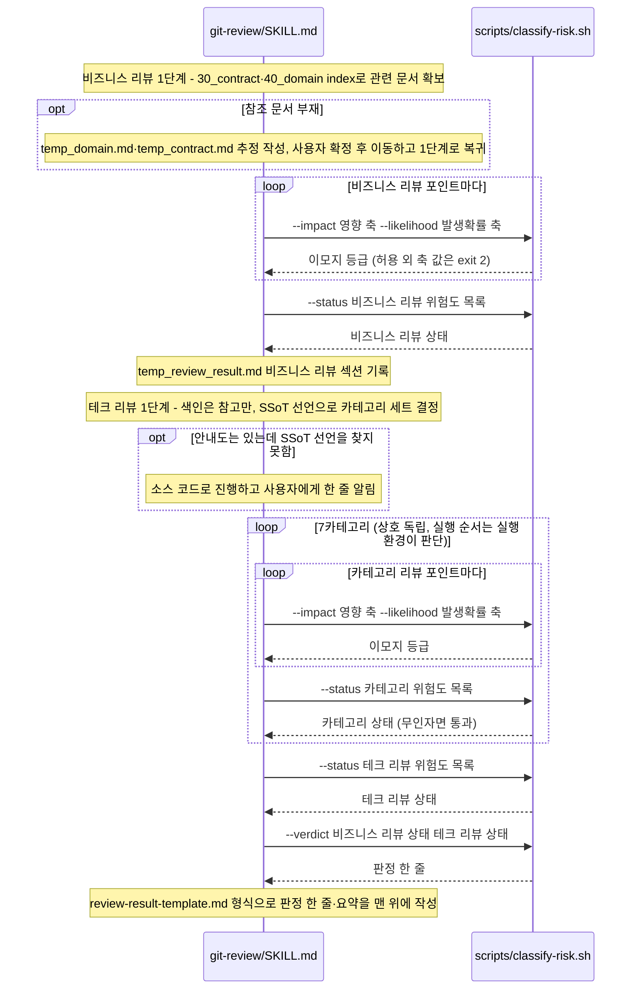

# git-review 리뷰 호출 흐름

## What

PR 또는 Self 리뷰를 비즈니스 리뷰와 테크 리뷰 두 단계로 수행하고, 위험도·상태·판정을 헬퍼로 산출해 결과 템플릿에 기록한다. 외부 게시는 없다.

## How

```
git-review/SKILL.md
├── 비즈니스 리뷰
│   ├── 1단계: 참조 문서 확보          # .ai/30_contract·40_domain index → 관련 문서만 읽기
│   │   └── 문서 부재 시 처리          # .ai/99_workspace/temp_domain.md·temp_contract.md 추정 작성 → 사용자 확정 → 30_contract·40_domain 이동
│   ├── 2단계: 비즈니스 리뷰 수행      # 계약·도메인 정책 위반은 영향 축 "스펙·기능 달성 차단"
│   │   ├── scripts/classify-risk.sh --impact <축> --likelihood <축>   # 리뷰 포인트마다 등급
│   │   └── scripts/classify-risk.sh --status [<위험도>…]              # 비즈니스 리뷰 상태
│   └── 3단계: 결과 기록               # .ai/99_workspace/temp_review_result.md
└── 테크 리뷰
    ├── 1단계: 코드베이스 색인 참조     # .ai/60_codebase/index.md 는 참고만, SSoT는 AI-CONTEXT.md 본문 2번째 줄 선언으로 직접 확인(선언 없으면 소스 코드, 안내도는 있는데 선언을 찾지 못하면 사용자에게 알림)
    ├── 2단계: 카테고리별 검증 (7카테고리)   # 선언이 원본 문서면 doc 카테고리 7종(같은 개수·순서), 소스 코드이거나 없으면 코드 7종
    │   ├── scripts/classify-risk.sh --impact <축> --likelihood <축>   # 매트릭스로 등급 "<이모지> <등급>"
    │   └── scripts/classify-risk.sh --status [<위험도>…]              # 단계 상태, 무인자면 통과(PASS)
    └── 3단계: 결과 기록
        ├── scripts/classify-risk.sh --verdict <상태> <상태>            # 두 단계 상태의 최고값으로 판정 한 줄
        └── templates/review-result-template.md                        # 역피라미드, 항목 단위 접기, 원본 문서 선언이면 카테고리 행 이름만 doc 카테고리로
```

### 시퀀스 다이어그램



## Why

- 근거는 `git-review/SKILL.md` `## 위험도 분류`(리뷰어가 등급을 직접 고르지 않는다), `## 상태 산출`(최고 위험도, LOW·INFO는 상태를 낮추지 않음), `## 판정 산출`(이모지 SSoT 대응표), `## 결과 기록 형식`에 있다.
- `classify-risk.sh`는 issue-audit에도 있으나 내용이 다르다(issue-audit 쪽이 `--treatment`·`--compliance` 추가). 스킬 독립성 원칙으로 공유하지 않는다([ADR 0002](../../50_adr/active/0002-skill-independence-intentional-duplication.md)). 매트릭스 원본은 issue-audit이고 카테고리 7종과 doc 카테고리 7종의 원본은 이 스킬이다.
- 명세: [리뷰 결과 산출 요건](../../40_domain/specs/git-review-output.md). 등급을 축·매트릭스로 산출하고 이 스킬에서는 우선순위 표시로만 쓰는 결정은 [ADR 0006](../../50_adr/active/0006-risk-matrix-and-treatment.md), 역피라미드·상태·판정 산출·신호등 이모지와 doc 카테고리 세트는 [ADR 0014](../../50_adr/active/0014-inverted-pyramid-and-verdict-derivation.md). doc 프로파일의 SSoT를 원본 문서로 둔 결정과 선언을 찾지 못했을 때의 알림(#122 일부 변경)은 [ADR 0020](../../50_adr/active/0020-doc-ssot-original-documents-and-publishing-deferred.md).
- 원장 [K-0002](../../70_ledger/active/K-0002-audit-axis-tiebreak-absent.md): 영향·발생확률 축의 경계 판정 우선 규칙이 없다. issue-audit 항목이지만 같은 매트릭스를 쓰는 이 스킬에도 해당한다.
- 헬퍼·테스트 배치는 [ADR 0001](../../50_adr/active/0001-skill-deterministic-helper-test-convention.md).
