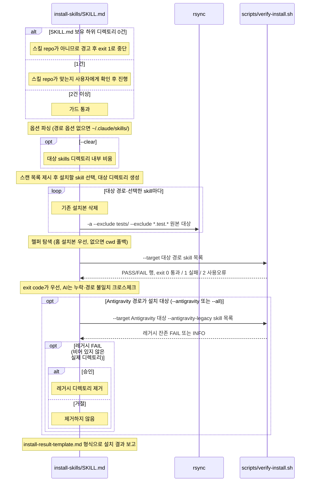

# install-skills 설치 호출 흐름

## What

현재 스킬 repo의 skill을 선택해 5개 AI 도구 경로에 복사하고, 배포 제외 경로가 빠졌는지 헬퍼로 검증한다. 홈에 한 벌만 두고 어느 스킬 repo에서든 실행하는 self-install형이다.

## How

```
install-skills/SKILL.md
├── 스킬 repo 판별 가드        # */SKILL.md 0건이면 exit 1, 1건이면 스킬 repo인지 질의
├── 1. 옵션 파싱               # --claude·--agents·--antigravity·--codex·--junie·--all·--clear·--self, 경로 옵션 없으면 ~/.claude/skills/
├── 2. --clear                 # rm -rf <target>/* (대상 내부 비움)
├── 3. 설치 대상 선택          # 스캔 목록(SKILL.md 보유 1차 하위, install-skills 제외·--self면 포함, description 병기)에서 번호·skill명 질의 (all 가능)
├── 4. 대상 디렉토리 생성
├── 5. 배포                    # rm -rf "$target/$s" → rsync -a --exclude 'tests/' --exclude '*.test.*' (폴백 cp + find -delete). 제외 패턴의 단일 출처
├── 6. 검증                    # 헬퍼는 홈 설치본(~/.claude/skills/install-skills/) 우선, 없으면 cwd 폴백. exit code가 우선이고 AI는 크로스체크
│   ├── scripts/verify-install.sh --target <dir>… [--antigravity-legacy] <skill>…   # 디렉토리·SKILL.md 존재, tests/·*.test.* 미포함, 레거시 잔존, exit 0/1/2. --antigravity-legacy 는 Antigravity 대상일 때만 별도 실행
│   └── references/antigravity-legacy.md   # 레거시 경로 판정 상세
├── 7. 레거시 제거             # Antigravity 경로 한정, FAIL 시 승인 후에만 (INFO는 보존)
└── 8. 보고                    # templates/install-result-template.md
```

### 시퀀스 다이어그램



생략한 호출은 위 트리에서 확인한다.

## Why

- 근거는 `install-skills/SKILL.md` `### Self-install 부트스트랩`(홈에 한 벌, 복제본 없이 실행)과 `## 개요`(클린 설치, 배포 제외 목록의 단일 출처는 5단계)에 있다.
- 배포 시 `tests/`를 제외하는 결정은 [ADR 0001](../../50_adr/active/0001-skill-deterministic-helper-test-convention.md)이며, ADR은 제외 패턴을 복제하지 않고 이 스킬의 5단계를 참조한다.
- 원장 [K-0005](../../70_ledger/active/K-0005-install-template-exclude-pattern-literal.md): 설치 결과 템플릿이 제외 패턴 리터럴을 복제한다(수용).
- 계약: [AI 도구별 스킬 포맷과 설치 경로](../../30_contract/ai-tool-skill-paths.md)(경로 5종, Antigravity 공식·구 경로, 배포 제외). 명세: [스킬 설치 요건](../../40_domain/specs/install-skills.md).
- self-install 전환, 헬퍼 홈 우선 탐색 예외, 스킬 repo 가드, 보고 템플릿 고정은 [ADR 0009](../../50_adr/active/0009-install-skills-self-install.md).
