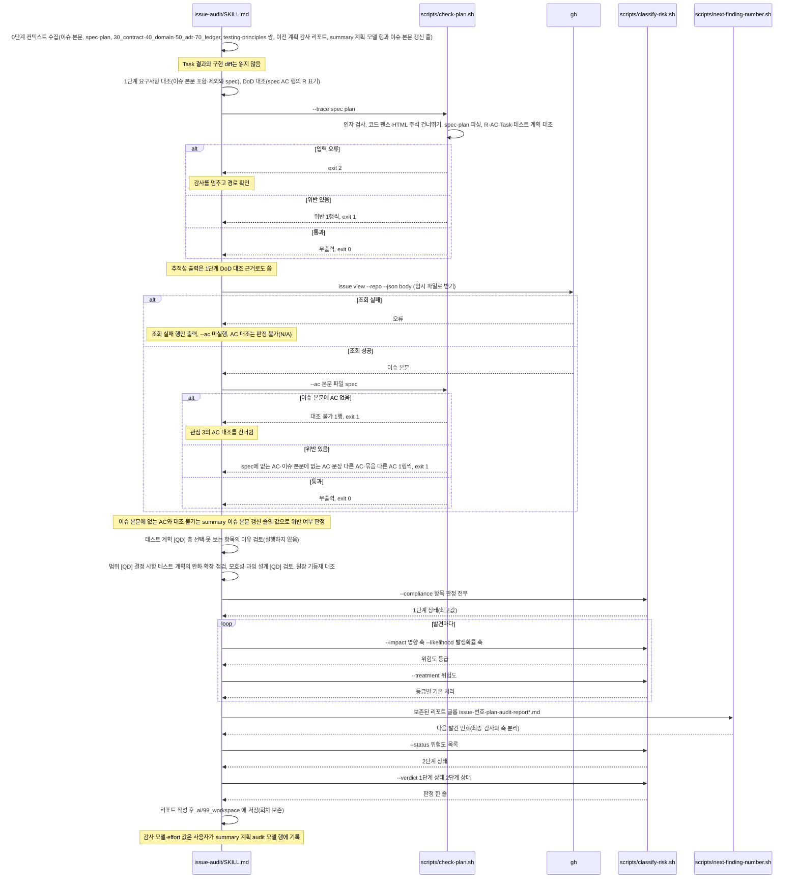

# issue-audit 계획 감사(--plan) 호출 흐름

## What

구현 전 spec·plan 자체를 GitHub 이슈 본문과 `.ai` 문서에 대조한다. issue-work 진행 루프의 계획 검증 단계에서 이슈마다 사용자가 수행 여부를 정하고(첫 회차는 계획 종료 게이트 뒤·Task 0 앞), 계획 모델과 다른 벤더 모델로 직접 실행한다. 뒤 회차에 다시 받는 조건은 issue-work "새 이슈 시작 시" 5단계가 정한다.

## How

```
issue-audit/SKILL.md `### --plan`
├── 0단계: 컨텍스트 수집          # 이슈 본문, .ai/30_contract·40_domain·50_adr·70_ledger, testing-principles 쌍(있으면, 7항. 실행하지 않고 층 표만 관점 2의 기준), 이전 리포트 issue-<번호>-plan-audit-report*.md(6항), summary는 계획 모델 행과 `이슈 본문 갱신` 줄만 (Task 결과·구현 diff 제외)
├── 1단계: 적합성 검증            # 대조 표 둘, 결정 사항 대조 표는 두지 않음 (PASS/FAIL/PARTIAL/N/A)
│   ├── 요구사항 대조             # 행 = 이슈 본문 포함·제외 항목 ↔ spec 포함 R·제외 목록, `검토 필요` 항목(판정 불가). 제외 항목을 승인 근거 없이 포함 R로 옮겼으면 미충족
│   └── 완료의 정의(DoD) 대조     # 행 = spec AC 행, 행 끝 `(R<n>)`이 포함 목록에 있는지(--trace 출력 근거). `AC 없는 R`은 AC 칸 `-` 행으로 더해 FAIL
├── 2단계: 비판적 검증 5관점
│   ├── 추적성 [D]                # scripts/check-plan.sh --trace <spec> <plan>, 출력 1행이 발견 1건
│   │   ├── AC 대조               # --trace와 블록 분리. gh issue view --repo --json body > mktemp 파일, 조회 성공 시만 check-plan.sh --ac <본문> <spec> (프로세스 치환 금지), --ac 종료 코드는 rm -f 뒤 블록 종료 코드로 반환. 조회 실패는 `조회 실패` 행만 내고 판정 불가(N/A)·발견 아님
│   │   └── 본문에 없는 AC 판정   # `이슈 본문에 없는 AC`·`대조 불가`는 summary `이슈 본문 갱신` 줄로: 비어 있음 = 보강 대기(위반 아님) / `거절 · <AC 번호>` = 그 번호와 `대조 불가`는 위반 아님 / `갱신`·`대상 아님` = 위반. 보강 대기는 본문 AC가 대응하지 않는 R에 붙은 AC만, 나머지는 관점 3의 확장
│   ├── 테스트 계획 [QD]          # 층 선택(단위 먼저, 위 층의 이유, local 층 표), 못 보는 항목의 이유, 테스트가 AC의 결과를 보는지. 테스트를 실행하지 않음
│   ├── 범위 [QD]                 # spec `결정 사항`·plan `테스트 계획`이 이슈 AC를 완화(오류 상황 제외·조건 약화·AC 삭제·제외 이동)하거나 확장(AC에 없는 결과, 본문 AC가 이미 대응하는 R에 더한 AC)하는지. `--ac` 출력과 두 번 세지 않음, `대조 불가`면 AC 대조 건너뜀
│   └── 모호성·과잉 설계 [QD]     # 모호성은 `결정 사항`·`설계 결정`에 빠진 결정(이슈 본문 `정한 것` 포함)도 봄
├── 공통 규칙                     # classify-risk.sh 등급·처리·상태·판정, 원장 대조, next-finding-number.sh 는 최종 감사와 동일
└── 결과 기록                     # .ai/99_workspace/issue-<번호>-plan-audit-report.md, 회차 보존·--clear 이관 동일, F- 번호 축은 최종 감사와 분리, 감사 모델·effort 줄 값은 summary 계획 audit 모델 행에 사용자가 기록
```

추적성 헬퍼 내부:

```
check-plan.sh --trace <spec> <plan> | --ac <이슈 본문> <spec>
├── export LC_ALL=C               # 문자열을 바이트로 견줌 (macOS awk의 == 는 en_US.UTF-8에서 다른 한글 문자열을 같다고 봄)
├── 인자 검사                     # 모드 미지정·모드 중복·인자 부족·읽을 수 없는 파일·알 수 없는 옵션은 exit 2
├── skip (awk 전처리, 모든 파서 공통)
│   ├── 코드 펜스 상태            # ```·~~~, 여는 문자·길이를 기억해 같은 문자 같은 개수 이상에서만 닫힘
│   ├── HTML 블록 주석 상태       # 여러 줄 주석 안 행 건너뜀, `--> <!--` 연속 주석은 after_close 로 이어짐
│   └── scan                      # 행 안 주석·인라인 코드를 왼쪽부터 읽어 먼저 시작한 쪽이 이김
├── ac_fn (awk 함수, AC 행을 읽는 파서 공통)
│   ├── ac_no                     # `- [ ] AC<n>: `(`[x]` 포함) 행이면 번호와 주석을 지운 문장
│   └── cut_r                     # 문장 끝의 `(R<n>[, R<m>])` 하나를 떼어 R 표기로 둠
├── --trace
│   ├── spec 파서                 # 포함 표지 `### 포함`(scan 결과로 판정)부터 다음 `### `·`## `·구분선 앞까지의 `- R<n>: ` → INC(`#### ` 묶음 제목과 굵은 글씨 행은 목록을 끊지 않음), `## 완료의 정의` 안 AC 행 → AC·ACREF, R 표기 없으면 NOREF
│   ├── plan 파서                 # `### Task ` 블록별 `대상 요구사항` 값의 R<n> → REF, 없으면 NOFIELD (고정 Task 0·N 제외). `## 테스트 계획` 안에서 머리가 `| AC | 레벨 | 층 |`·`| AC | 레벨 | 누가 보나 |`로 시작하는 표의 `| AC<n> |` 행 → TEST
│   └── 대조 9종                  # 추적 불가 / AC 없는 R / Task 없는 R / 없는 R 참조(자리) / 대상 요구사항 없는 일반 Task / R 표기 없는 AC(행) / 중복 AC(행) / 테스트 계획 없는 AC / 없는 AC 참조 → 1행씩·exit 1
└── --ac
    ├── 이슈 본문 파서            # `- [ ] AC<n>: `·`- [x] AC<n>: ` 행 → 번호·묶음 제목(`### `)·문장. 0개면 `대조 불가: 이슈 본문에 AC 없음` 1행만·exit 1
    ├── spec 파서                 # `## 완료의 정의` 안 AC 행 → 번호·묶음 제목·R 표기를 뗀 문장
    └── 대조 4종                  # spec에 없는 AC / 이슈 본문에 없는 AC / 문장 다른 AC / 묶음 다른 AC → 1행씩·exit 1. 같은 번호의 행이 여럿이면 모두 첫 행과 견줌
```

### 시퀀스 다이어그램



## Why

- 근거는 `issue-audit/SKILL.md` `### --plan` 소절(시점·입력·대조 기준·판정 매핑·5관점)과 `check-plan.sh` 머리말(읽는 앵커, 판정 순서, 행 단위 경계)에 있다.
- 원장 [K-0009](../../70_ledger/active/K-0009-plan-audit-fake-d-check-manual.md): 가짜 `[D]` 사전 판별의 헬퍼 결정화 보류(기술부채). #145가 그 판별 절차를 빼 함께 해소 대상이며 해소는 PR 번호를 알 때 적는다. [K-0010](../../70_ledger/active/K-0010-check-plan-line-based-markdown-boundary.md): 행 단위 파서라 여러 행 코드 스팬 등은 구분하지 않음(known issue, `--ac`도 같은 경계를 이어받음). [K-0023](../../70_ledger/archive/K-0023-check-plan-include-label-trailing-comment.md): 행 끝에 닫힌 주석이 붙은 `**포함**` 라벨을 인식하지 못하던 경계. #140에서 포함 표지를 scan 결과로 판정하게 고쳐 해소했다.
- AC 대조(`--ac`)와 관점 3의 완화·확장 점검은 이슈 본문·spec·PR이 같은 AC 번호를 쓰는 결정의 일부다([ADR 0026](../../50_adr/active/0026-acceptance-criteria-across-issue-spec-pr.md)). 문장·묶음까지 견주는 대조, `테스트 계획` 대응, 이슈 본문에 없는 AC를 `이슈 본문 갱신` 줄로 판정하는 이유, 1단계에 요구사항 대조를 남긴 이유는 [ADR 0031](../../50_adr/active/0031-issue-work-loop-and-one-sentence-requirements.md).
- 계획 감사 리포트의 보정은 issue-work `--response`가 spec·plan에 반영하고 건수를 summary `계획 감사` 줄에 적는다([--response 흐름](../issue-work/response-call-flow.md)).
- 명세: [이슈 감사 요건](../../40_domain/specs/issue-audit.md) `--plan` 항목. 요구사항 층·계획 감사 모드·수행 여부 사용자 선택은 [ADR 0016](../../50_adr/active/0016-spec-requirements-layer-and-plan-audit.md). 검증 레벨의 정의는 [ADR 0003](../../50_adr/active/0003-verification-levels-and-determinization.md)이며, 가짜 `[D]` 사전 판별은 테스트 먼저 Task의 실패 확인이 대신한다(ADR 0031).
- 0단계 7항의 테스트 실행 원칙 파일 쌍 참조와 관점 2의 층 표 기준은 [ADR 0023](../../50_adr/active/0023-testing-principles-pair-and-consumer-skill-references.md).
- 헬퍼·테스트 배치는 [ADR 0001](../../50_adr/active/0001-skill-deterministic-helper-test-convention.md).
