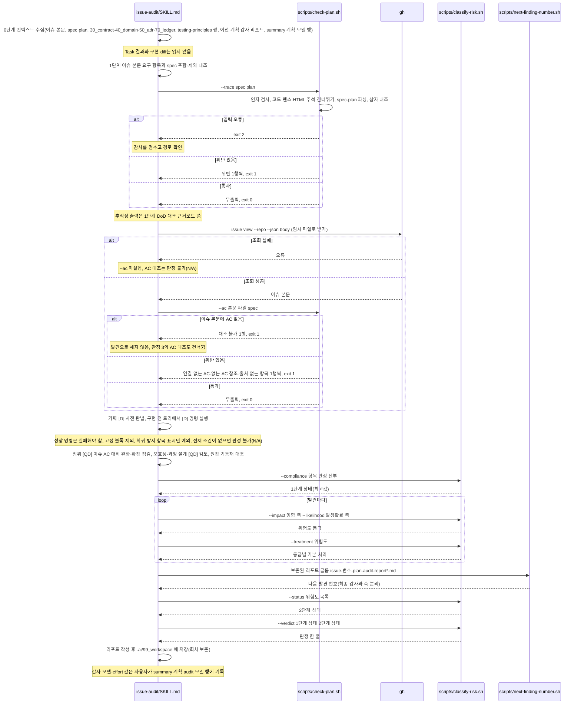

# issue-audit 계획 감사(--plan) 호출 흐름

## What

구현 전 spec·plan 자체를 GitHub 이슈 본문과 `.ai` 문서에 대조한다. issue-work 계획 종료 게이트 뒤·Task 0 앞에 이슈마다 사용자가 수행 여부를 정하고, 계획 모델과 다른 벤더 모델로 직접 실행한다.

## How

```
issue-audit/SKILL.md `### --plan`
├── 0단계: 컨텍스트 수집          # 이슈 본문, .ai/30_contract·40_domain·50_adr·70_ledger, testing-principles 쌍(있으면, 7항), 이전 리포트 issue-<번호>-plan-audit-report*.md(6항), summary는 모델 기록 표의 계획 모델 행만 (Task 결과·구현 diff 제외)
├── 1단계: 적합성 검증            # 행 = 이슈 본문 요구 항목 ↔ spec 포함·제외 (PASS/FAIL/PARTIAL/N/A), DoD 표는 포함 R ↔ `### R<n>` 그룹
├── 2단계: 비판적 검증 5관점
│   ├── 추적성 [D]                # scripts/check-plan.sh --trace <spec> <plan>
│   │   └── AC 대조               # gh issue view --repo --json body > mktemp 파일, 조회 성공 시만 check-plan.sh --ac <본문> <spec> (프로세스 치환 금지). `대조 불가`는 AC 없는 이슈의 정상 경로라 발견 아님, 조회 실패는 판정 불가(N/A)
│   ├── 가짜 [D] 사전 판별 [D]    # 구현 전 트리에서 [D] 명령 실행, 정상 명령은 실패해야 함, 고정 블록(Task 0·N) 완료 기준은 제외, 회귀 방지 항목은 spec 본문 `(회귀 방지 항목)` 표시로 예외 (수동). local 파일이 있으면 그 실행 셸로 실행하고 전제 조건이 없으면 판정 불가(N/A)로 두어 후보·정상 실패 어느 쪽으로도 세지 않음
│   ├── 범위 [QD]                 # 이슈 AC 대비 spec 완료의 정의의 완화(오류 상황 제외·조건 약화·AC 삭제·제외 이동·연결 없는 AC)와 확장(AC에 없는 결과) 보고. 근거 있는 `(AC 없음: …)` 항목은 확장 아님, AC 없는 이슈는 건너뜀
│   └── 모호성·과잉 설계 [QD]
├── 공통 규칙                     # classify-risk.sh 등급·처리·상태·판정, 원장 대조, next-finding-number.sh 는 최종 감사와 동일
└── 결과 기록                     # .ai/99_workspace/issue-<번호>-plan-audit-report.md, 회차 보존·--clear 이관 동일, F- 번호 축은 최종 감사와 분리, 감사 모델·effort 줄 값은 summary 계획 audit 모델 행에 사용자가 기록
```

추적성 헬퍼 내부:

```
check-plan.sh --trace <spec> <plan> | --ac <이슈 본문> <spec>
├── 인자 검사                     # 모드 미지정·모드 중복·인자 부족·읽을 수 없는 파일·알 수 없는 옵션은 exit 2
├── skip (awk 전처리, 모든 파서 공통)
│   ├── 코드 펜스 상태            # ```·~~~, 여는 문자·길이를 기억해 같은 문자 같은 개수 이상에서만 닫힘
│   ├── HTML 블록 주석 상태       # 여러 줄 주석 안 행 건너뜀, `--> <!--` 연속 주석은 after_close 로 이어짐
│   └── scan                      # 행 안 주석·인라인 코드를 왼쪽부터 읽어 먼저 시작한 쪽이 이김
├── --trace
│   ├── spec 파서                 # `**포함**` 아래 `- R<n>: ` → INC, `## 완료의 정의` 안 `### R<n>: ` → DOD
│   ├── plan 파서                 # `### Task ` 블록별 `대상 요구사항` 값의 R<n> → REF, 없으면 NOFIELD (고정 Task 0·N 제외)
│   └── 대조                      # R 없는 DoD 그룹 / DoD 없는 R / Task 없는 R / 대상 요구사항 없는 일반 Task / 추적 불가 → 1행씩·exit 1
└── --ac
    ├── 이슈 본문 파서            # `- [ ] AC<n>: `·`- [x] AC<n>: ` 행 → AC 집합, 0개면 `대조 불가: 이슈 본문에 AC 없음` 1행만·exit 1
    ├── spec 파서                 # `## 완료의 정의` 안 `- [ ] [D|QD|ND]` 항목 행(`[x]` 포함, 하위 행 제외)의 `(AC<n>[, AC<m>])`·`(AC 없음: <사유>)`, 인라인 코드 안 표기는 제외
    └── 대조                      # 연결 없는 AC / 없는 AC 참조 / 출처 없는 항목(`### 공통` 회귀 방지 항목 제외) → 1행씩·exit 1
```

### 시퀀스 다이어그램



## Why

- 근거는 `issue-audit/SKILL.md` `### --plan` 소절(시점·입력·대조 기준·판정 매핑·5관점)과 `check-plan.sh` 머리말(읽는 앵커, 판정 순서, 행 단위 경계)에 있다.
- 원장 [K-0009](../../70_ledger/active/K-0009-plan-audit-fake-d-check-manual.md): 가짜 `[D]` 사전 판별의 헬퍼 결정화 보류(기술부채). [K-0010](../../70_ledger/active/K-0010-check-plan-line-based-markdown-boundary.md): 행 단위 파서라 여러 행 코드 스팬 등은 구분하지 않음(known issue, `--ac`도 같은 경계를 이어받음).
- AC 대조(`--ac`)와 관점 3의 완화·확장 점검은 이슈 AC를 spec·PR까지 같은 번호로 잇는 결정의 일부다([ADR 0026](../../50_adr/active/0026-acceptance-criteria-across-issue-spec-pr.md)). AC 없는 이슈의 `대조 불가`를 발견으로 세지 않고 AC 보강을 issue-work 6단계에 맡기는 근거도 같은 ADR에 있다.
- 계획 감사 리포트의 보정은 issue-work `--response`가 spec·plan에 반영하고 건수를 summary `계획 감사` 줄에 적는다([--response 흐름](../issue-work/response-call-flow.md)).
- 명세: [이슈 감사 요건](../../40_domain/specs/issue-audit.md) `--plan` 항목. 요구사항 층·계획 감사 모드·수행 여부 사용자 선택은 [ADR 0016](../../50_adr/active/0016-spec-requirements-layer-and-plan-audit.md). 가짜 `[D]` 함정("틀렸을 때 검사가 실제로 실패하나")은 [ADR 0003](../../50_adr/active/0003-verification-levels-and-determinization.md) 근거 절.
- 0단계 7항의 테스트 실행 원칙 파일 쌍 참조와 가짜 `[D]` 판별의 실행 셸·판정 불가(N/A)는 [ADR 0023](../../50_adr/active/0023-testing-principles-pair-and-consumer-skill-references.md).
- 헬퍼·테스트 배치는 [ADR 0001](../../50_adr/active/0001-skill-deterministic-helper-test-convention.md).
