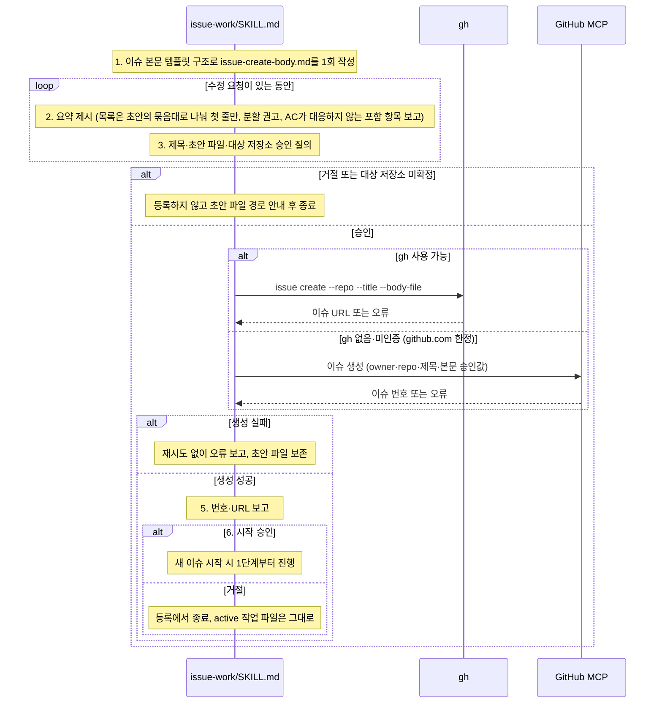

# issue-work 이슈 등록(--create) 호출 흐름

## What

대화에서 정한 작업을 이슈 본문 템플릿 구조로 초안을 쓰고, 승인받은 뒤 GitHub 이슈로 등록한다. 등록 때부터 완료의 정의(AC)가 있는 이슈가 되며, 이어서 "새 이슈 시작 시"를 진행할지 묻는다. 시작을 승인하기 전에는 active 작업 파일을 옮기거나 지우지 않는다.

## How

```
issue-work/SKILL.md `### --create`
├── 1. 초안 작성                        # templates/issue-body-template.md 구조로 .ai/99_workspace/issue-create-body.md 1회, 이미 있으면 덮어쓸지 질의, 제목은 파일 밖에서 따로 정함
├── 2. 요약 제시                        # 경로·제목 전문·목표 한 줄·포함·제외·AC 수·검토 필요만, 초안 전문은 출력 안 함
│   ├── 목록 제시                       # 포함·제외 목록은 초안의 묶음대로 나눠 항목 첫 줄만, 하위 목록은 파일에서 확인
│   ├── 분할 권고                       # 서로 독립으로 머지할 수 있는 항목이 있으면 권고, 수치 기준 없음, 결정은 사용자
│   └── AC 대응 점검                    # 포함 항목 하나가 AC 하나 이상의 결과로 판정되는지, AC 없는 포함 항목 보고(없으면 `없음`)
├── 3. 승인                             # 승인 대상: 제목·초안 파일·대상 저장소, 승인 전 gh issue create 미실행
│   ├── 대상 저장소                     # upstream 원격 URL → 없으면 branch.<브랜치>.remote → 정할 수 없으면 질의, 못 정하면 등록 안 함
│   ├── 수정 요청                       # 같은 파일 갱신 후 2단계부터 다시
│   └── 거절                            # 초안 파일 경로 안내 후 종료
├── 4. 등록
│   ├── gh issue create --repo '<대상 저장소>' --title '<제목>' --body-file '.ai/99_workspace/issue-create-body.md'   # 값은 작은따옴표 인용
│   ├── 폴백: GitHub MCP 이슈 생성      # gh 없음·미인증, github.com 한정, owner·repo·제목·본문 모두 승인값
│   └── 실패                            # 재시도 없이 오류 보고, 초안 파일 보존
├── 5. 번호 보고                        # 이슈 번호·URL
└── 6. 시작 질의                        # 승인하면 "새 이슈 시작 시" 1단계부터(진행 중 active/ 이슈가 archive/로 옮겨진다는 사실을 함께 알림), 거절하면 등록에서 종료
```

### 시퀀스 다이어그램



## Why

- 이슈 등록 때 AC를 정하고 이슈 본문·spec·PR이 같은 AC 번호를 쓰게 하는 결정, 분할 권고에 수치 기준을 두지 않는 이유는 [ADR 0026](../../50_adr/active/0026-acceptance-criteria-across-issue-spec-pr.md).
- 이슈 등록은 외부 공개 행위라 승인 없이 실행하지 않는다([승인 게이트 정책](../../40_domain/policies/local/external-action-approval-gate.md)). 초안을 파일에 1회 쓰고 대화에는 요약만 내는 방식은 [ADR 0013](../../50_adr/active/0013-long-output-single-file-generation.md). 승인 뒤 초안 파일 내용을 다시 대조하지 않는 구조는 원장 [K-0003](../../70_ledger/active/K-0003-approved-file-content-unverified.md)과 같다.
- `--repo` 필수, 동적 값 작은따옴표 인용, MCP 폴백 github.com 한정은 [GitHub 연동 계약](../../30_contract/github-integration.md).
- 명세: [이슈 단위 작업 워크플로우 요건](../../40_domain/specs/issue-workflow.md) 옵션 표의 `--create` 행.
