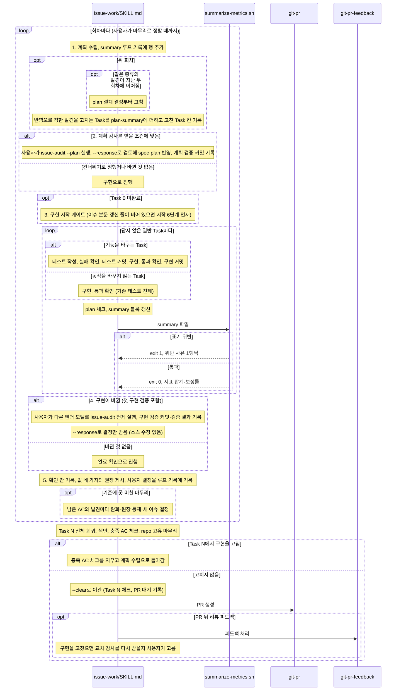

# issue-work 진행 루프 호출 흐름

## What

이슈를 계획 수립 → 계획 검증 → 구현 → 구현 검증 → 완료 확인의 다섯 단계로 진행한다. 한 번 지나는 것이 한 회차이고, 완료 확인에서 사용자가 `다음 회차`로 정하면 계획 수립으로 돌아가고 `마무리`로 정하면 Task N에 들어간다. 첫 회차의 계획 수립과 계획 검증의 상세는 [새 이슈 시작 흐름](start-call-flow.md), 감사 리포트 검토는 [--response 흐름](response-call-flow.md), 이관은 [--clear 흐름](clear-call-flow.md)에 있다.

## How

```
issue-work/SKILL.md `## 진행 루프` (+ `## 작업 진행 중`)
├── 공통 기록                           # 회차를 시작할 때 summary `루프 기록`에 한 행을 더하고 단계마다 채움
│   ├── 감사 전 커밋                    # 감사 대상(계획 감사는 spec·plan, 교차 감사는 구현과 spec·plan)에 미커밋 변경이 있으면 커밋할지 질의
│   └── 검증 기록                       # 감사를 받으면 `계획 검증 커밋`·`구현 검증 커밋`에 리포트 머리말의 감사 대상 커밋(미커밋 산출물이 있으면 `(미커밋 포함)`, 받지 않은 칸은 `-`, 여러 번 받으면 마지막 감사), `검증 결과`에 감사 종류·머리말 회차(`계획 2차`, `최종 1차`)
├── 1. 계획 수립                        # 첫 회차는 `새 이슈 시작 시` 1~4단계, 뒤 회차는 지난 결정을 반영해 수정 (1~3단계를 다시 밟지 않음)
│   ├── spec                            # 요구사항·AC·결정이 바뀔 때만, 변경 통제를 거쳐 `변경 이력`에 한 줄
│   ├── plan                            # 반영으로 정한 발견을 고치는 Task를 Task N 앞에 다음 번호로, 필요하면 `설계 결정`·`테스트 계획`도. 번호는 summary `종류별 발견`의 `고친 Task`에
│   ├── summary                         # 더한 Task의 블록을 plan과 같은 순서로
│   └── 같은 종류의 발견                # `종류별 발견`에서 같은 종류가 지난 회차와 그 앞 회차에 이어지면 Task를 더하기 전에 `설계 결정`부터
├── 2. 계획 검증                        # 수행으로 정한 이슈만. AC·요구사항, `설계 결정`, `테스트 계획`(`확인` 칸 제외) 가운데 하나가 바뀌면 다시 받음. 6단계·Task 0에서 바뀐 것도 같고 일반 Task 전에 받음
│   ├── 판별                            # `계획 검증 커밋`에 값이 있는 가장 최근 행의 커밋 뒤 diff. `(미커밋 포함)`이면 diff 없이 바뀐 것으로 봄. 기존 AC 안의 Task 추가만으로는 받지 않음
│   └── 계획 감사                       # 사용자가 계획 모델과 다른 벤더 모델로 issue-audit --plan 실행 → --response 로 검토
├── 3. 구현
│   ├── Task 0: 구현 시작 게이트        # summary `이슈 본문 갱신` 줄이 비어 있으면 시작 6단계 먼저. 모호점을 질의해 spec `결정 사항`·plan `설계 결정`에, 없으면 `전제 누락 없음`
│   ├── 일반 Task                       # 완료 시 plan 체크, summary 블록(지표 5종·`테스트`·`대응 발견`)과 다음 작업 갱신
│   │   ├── 테스트 먼저                 # 테스트 작성 → 실패 확인 → 테스트 커밋 → 구현 → 통과 확인 → 구현 커밋. 발견을 고치는 Task는 재현 테스트부터
│   │   ├── 테스트를 먼저 쓰지 않음     # 문서만·화면 배치·스파이크·리팩터링 넷만. 구현 → 통과 확인(기존 테스트 전체), 이유 한 줄
│   │   └── scripts/summarize-metrics.sh <summary>   # 수치 지표 3종 표기 검사·보정률 집계, 위반은 exit 1
│   └── 변경 통제                       # 구체화: 질의 없이 `결정 사항`·`테스트 계획`에 / 확장: 범위 확장(본문 갱신+재승인)·원장 등재·새 이슈 중 선택 질의 / 완화: 재승인 없이 반영 안 함(커밋한 테스트의 기대값 변경·단언 축소·삭제 포함). 이름·위치·준비 코드·호출 방식만 바뀌는 테스트 수정은 질의 없이
├── 4. 구현 검증                        # 지난 검증 뒤에 구현이 바뀌었으면 전체 교차 감사, 위험도에 따른 예외 없음, 소스 수정 없음
│   ├── 판별                            # `구현 검증 커밋`에 값이 있는 가장 최근 행의 커밋 뒤 diff (값이 없으면 받음, `(미커밋 포함)`이면 diff 없이 바뀐 것으로 봄). 아래 넷 중 하나
│   │   ├── 제외 경로 밖 diff           # 제외: .ai/90_issues/·99_workspace/·70_ledger/ 와 plan Task N이 마무리로 적은 문서
│   │   ├── 제외 경로 안의 산출물 diff  # plan 일반 Task가 고친다고 적은 파일
│   │   ├── `테스트 계획` 줄            # [D]·[QD] 줄의 추가나 `확인` 외 칸 변경. `확인` 칸만 바뀐 것과 [ND] 줄은 세지 않음
│   │   └── AC와 결정                   # spec AC·결정의 추가나 문장 변경. 체크박스만 바뀐 것은 세지 않음
│   ├── 교차 감사                       # 사용자가 구현 모델과 다른 벤더 모델로 issue-audit 실행, 모델·effort는 summary `최종 audit 모델` 행에 사용자가 기록
│   └── --response                      # 결정만 받음, 반영분은 다음 회차 계획 수립에서 Task로
├── 5. 완료 확인                        # 건너뛰지 않음
│   ├── 확인 칸                         # 충족으로 판정된 AC의 [D]·[QD] 줄에 감사 회차(감사 대상 커밋에 같은 내용으로 있던 줄만), 새 리포트가 충족으로 보지 않은 줄은 비움. [ND] 줄은 사용자 확인 날짜
│   ├── 보이는 값                       # 1단계 상태·2단계 상태·종합 판정(리포트에서 옮김), `테스트 계획`의 확인한 줄 수/전체 줄 수
│   ├── 권장                            # 1단계 충족, 2단계 통과·주의, 모든 줄 확인, 반영으로 정한 발견 종결이 모두 맞으면 `마무리`, 그 밖은 `다음 회차`. 판정 불가 AC는 따로 보임
│   └── 결정                            # 사용자가 정해 `루프 기록`의 `결정`에. 기준에 못 미친 `마무리`는 남은 AC·발견마다 완화·원장 등재·새 이슈 결정
├── 마무리 (Task N)                     # 사용자가 `마무리`로 정한 뒤에만: 전체 회귀 → 색인 → 충족 AC 체크 → repo 고유 마무리 → --clear → PR. 교차 감사는 받지 않음
│   ├── 구현을 고칠 때                  # 계획 수립으로 돌아감, `루프 기록`에 다음 회차 행, spec에서 체크한 AC의 체크 해제
│   ├── --clear                         # archive 이관 직전에 Task N 체크와 summary `PR 대기(git-pr로 생성)` 기록
│   └── git-pr                          # 이관 뒤에 PR 생성
└── PR 뒤 피드백                        # 이슈 문서는 고치지 않음, 구현을 고쳤을 때 교차 감사를 다시 받을지는 사용자가 고름
    └── git-pr-feedback
```

### 시퀀스 다이어그램



## Why

- 루프의 다섯 단계와 돌아가는 길, 완료 확인의 결정 주체, 구현 검증에 예외를 두지 않는 이유, 같은 종류의 발견 규칙, 테스트 먼저 순서는 [ADR 0031](../../50_adr/active/0031-issue-work-loop-and-one-sentence-requirements.md).
- 구현 검증의 판별에서 이슈 작업 기록을 빼되 plan 일반 Task가 고친다고 적은 파일은 보는 이유, `테스트 계획` 줄의 변경을 구현 변경으로 세는 이유도 같은 ADR의 근거에 있다.
- 교차 감사를 사용자가 다른 벤더 모델로 직접 받고 구현 AI가 실행하지 않는 원칙은 [ADR 0004](../../50_adr/active/0004-cross-model-audit-and-response-gate.md). Task 0(구현 시작 게이트)과 `모델 기록` 표는 [ADR 0005](../../50_adr/active/0005-model-separation-gates.md).
- 변경 통제의 구체화·확장·완화 분류는 [ADR 0026](../../50_adr/active/0026-acceptance-criteria-across-issue-spec-pr.md). 확장·완화가 이슈 본문을 고칠 때는 [승인 게이트 정책](../../40_domain/policies/local/external-action-approval-gate.md)을 따른다.
- 검증 레벨 `[D]`·`[QD]`·`[ND]`는 [ADR 0003](../../50_adr/active/0003-verification-levels-and-determinization.md), 구현 테스트의 Task별 배치는 [ADR 0019](../../50_adr/active/0019-test-perspectives-and-task-level-placement.md). 테스트의 층·러너·셸은 repo의 테스트 층 표가 정한다([ADR 0023](../../50_adr/active/0023-testing-principles-pair-and-consumer-skill-references.md)).
- 지표 5종(`수행 모델`·`수행 effort`와 수치 3종)을 값이 없어도 남기는 이유는 `## 작업 진행 중`(사후 집계가 표기 고정에 의존)에 있다.
- 원장 [K-0045](../../70_ledger/active/K-0045-nd-only-issue-recommends-next-round.md): `[ND]` 줄만 있는 이슈는 전부 확인해도 `다음 회차`를 권장한다(수용).
- 명세: [이슈 단위 작업 워크플로우 요건](../../40_domain/specs/issue-workflow.md)(진행 루프, 게이트 요약). 세션이 바뀐 AI가 읽는 안내와 루프 그림은 `issue-work/templates/issue-workflow-template.md`에 있다.
- 헬퍼·테스트 배치는 [ADR 0001](../../50_adr/active/0001-skill-deterministic-helper-test-convention.md).
