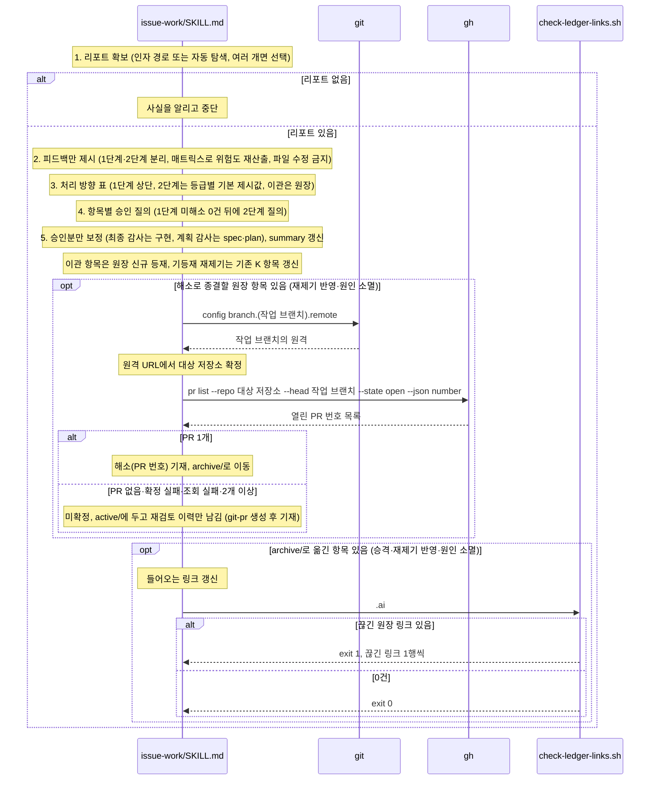

# issue-work --response 호출 흐름

## What

교차모델 audit 리포트(최종 감사·계획 감사)를 검토해 피드백을 먼저 제시하고, 항목별 승인을 받은 뒤 승인분만 보정한다. 이관은 원장 `.ai/70_ledger/`로 고정한다.

## How

```
issue-work/SKILL.md `### --response`
├── 1. 리포트 확보          # 인자 경로 또는 .ai/99_workspace/issue-<번호>-audit-report.md·-plan-audit-report.md 자동 탐색, 여러 개면 선택, 없으면 중단
├── 2. 피드백만 제시        # 1단계 발견(요구사항·DoD 대조)과 2단계 발견 분리, 위험도는 축 근거를 검토해 매트릭스로 재산출, 파일 수정 금지
├── 3. 처리 방향 표         # 2단계는 등급별 기본값(HIGH 반영·MEDIUM 판단·LOW 이관·INFO 보류), 1단계 미해소 건수 명시
├── 4. 항목별 승인 질의     # 순서 게이트: 1단계 FAIL·PARTIAL 미해소 0건 전에는 2단계 질의 금지, LOW 는 명시 승격 없이 보정 루프 제외
└── 5. 승인분만 보정
    ├── 대상 보정            # 최종 감사면 구현, 계획 감사면 spec·plan (R 이 바뀌면 3-1 승인 게이트 재수행)
    ├── summary 갱신         # 대상 Task 블록 `audit 발견`·`보정 반영` (계획 감사는 `계획 감사` 줄에 `수행 · 발견 N건 · 보정 N건`)
    └── 원장
        ├── 신규 등재        # .ai/70_ledger/ledger-entry-template.md → active/K-<번호>-<slug>.md, index.md 갱신, 수용 사유·재검토 조건 필수
        ├── 기등재 재제기    # 계속 수용(재검토 이력 추가) / 승격(이슈 #N, archive/) / 해소(PR #N, archive/), 새 번호 없음
        ├── 원인 소멸 종결   # 보정으로 원인이 사라진 active/ 항목을 해소로 archive/
        ├── 해소 기재 시점   # PR 있으면 기재, 없으면 미확정·재검토 이력만 남기고 git-pr 생성 후 기재로 (승격은 대상 아님)
        │   ├── git config branch.<작업 브랜치>.remote   # PR 유무 조회는 이슈 완료 시 원장 해소 기재와 같음, 원격 URL을 [호스트/]소유자/저장소로 읽어 대상 저장소 확정
        │   └── gh pr list --repo '<대상 저장소>' --head '<작업 브랜치>' --state open --json number   # 대상 저장소 확정·조회 실패나 PR 2개 이상이면 PR 없음 경로
        └── 옮긴 뒤 링크 갱신   # 승격·이번에 반영·원인 소멸 종결로 archive/에 옮긴 항목만, 이슈 완료 시 원장 해소 기재의 들어오는 링크 갱신을 같이 수행 (미확정으로 active/에 둔 항목 제외)
            └── scripts/check-ledger-links.sh '.ai'   # 끊긴 원장 링크 1행씩·exit 1
```

### 시퀀스 다이어그램



## Why

- 근거는 `### --response` 동작 2~5항에 있다. 등급을 직접 고치면 매트릭스가 걷어낸 재량이 되살아나고, 이관 목적지를 원장으로 고정해야 사유 없는 무한 보류를 막으며, 재검토 조건이 없으면 같은 발견이 매 감사마다 신규로 올라온다.
- 등급별 기본 처리 표의 값은 `issue-audit/SKILL.md` 등급별 기본 처리 기준을 따른다.
- 원장 [K-0013](../../70_ledger/active/K-0013-issue-work-pr-lookup-fork-same-branch.md): 해소 기재의 PR 유무 조회가 head 저장소를 대조하지 않아 같은 브랜치명의 포크 PR을 고를 수 있다(수용).
- 원장 형식은 ai-workspace가 배포하는 `ledger-entry-template.md`이며 git-pr-feedback과 공유한다([대응 흐름](../git-pr-feedback/respond-call-flow.md)).
- 명세: [이슈 단위 작업 워크플로우 요건](../../40_domain/specs/issue-workflow.md). 피드백 먼저·항목별 승인·1단계 우선 순서 게이트·지표 누적 규칙은 [ADR 0004](../../50_adr/active/0004-cross-model-audit-and-response-gate.md), 등급별 기본 처리는 [ADR 0006](../../50_adr/active/0006-risk-matrix-and-treatment.md), 원장을 이관 목적지로 고정한 결정과 상태 행렬은 [ADR 0007](../../50_adr/active/0007-tech-debt-ledger-location-and-structure.md), 해소 기재 시점은 [ADR 0018](../../50_adr/active/0018-ledger-proactive-review-and-resolve-timing.md), 옮긴 뒤 들어오는 링크 갱신과 끊긴 원장 링크 검사 헬퍼는 [ADR 0021](../../50_adr/active/0021-ledger-archive-move-link-update.md), 계획 감사 리포트 보정과 R 변경 시 승인 게이트 재수행은 [ADR 0016](../../50_adr/active/0016-spec-requirements-layer-and-plan-audit.md).
