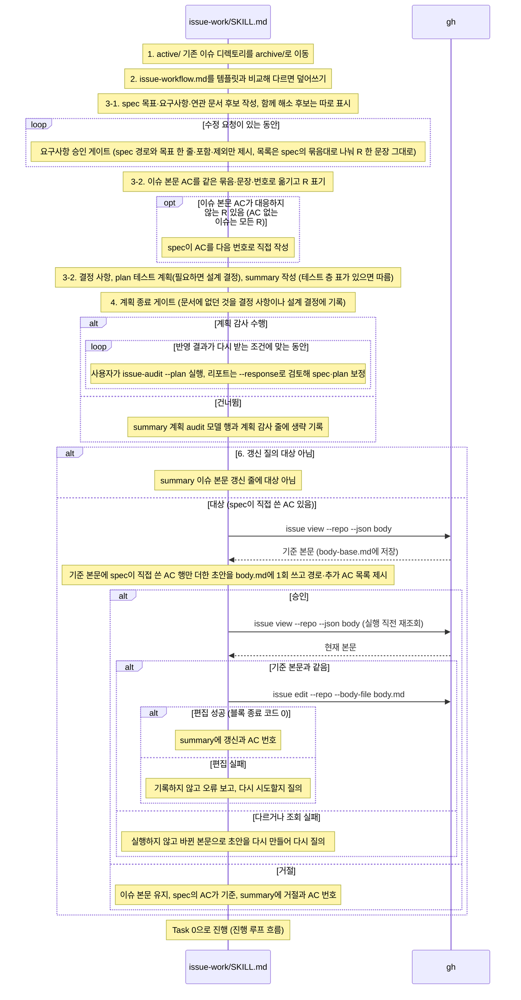

# issue-work 새 이슈 시작 호출 흐름

## What

이슈 단위로 spec·plan·summary를 만든다. 진행 루프의 다섯 단계 가운데 첫 회차의 계획 수립(1~4단계)과 계획 검증(5단계), 구현으로 가기 전의 이슈 본문 갱신 질의(6단계)에 해당한다. spec 요구사항은 사용자 승인 뒤에 완료의 정의·plan으로 이어지고, 요구사항과 완료의 정의는 이슈 본문의 묶음 제목·문장·AC 번호를 그대로 쓴다. 구현부터 마무리까지와 뒤 회차는 [진행 루프 흐름](loop-call-flow.md)에 있다.

## How

```
issue-work/SKILL.md `## 새 이슈 시작 시`
├── 1. active/ 기존 이슈 → archive/ 이동
├── 2. templates/issue-workflow-template.md → active/issue-workflow.md   # 템플릿이 SSoT, 다르면 덮어쓰기
├── 3-1. 승인 전                        # templates/issue-spec-template.md 로 목표·요구사항(`### 포함`·`### 제외`, 이슈 본문의 묶음 제목과 문장 그대로, R은 하위 목록 없는 한 문장)·연관 문서 후보 (30_contract·40_domain·50_adr index)
│   ├── 함께 해소 후보                  # 70_ledger index 의 관련 active/ 항목을 따로 표시·질의, 포함하면 R 첫 줄 끝에 `(함께 해소: K-<번호>)`, 미포함은 기록 안 함
│   └── 요구사항 승인 게이트            # spec 경로 + 목표 한 줄·포함·제외 목록만 제시(목록은 spec의 묶음대로 나눠 R 한 문장 그대로), 이슈 본문 근거 없는 항목은 표시·질의. 승인 전에는 완료의 정의·결정 사항·plan·summary를 쓰지 않음
├── 3-2. 승인 후                        # 완료의 정의·결정 사항, templates/issue-plan-template.md·issue-summary-template.md, summary `계획 모델` 행
│   ├── AC 옮기기                       # 이슈 본문 AC(`- [ ] AC<n>: `·`- [x] AC<n>: `)를 같은 묶음·문장·번호로, 행 끝에 `(R<n>[, R<m>])`. 포함 R마다 AC 1개 이상, 같은 번호의 행은 하나, 레벨 태그·검증 명령·케이스 목록 없음
│   │   └── AC 없는 R                   # 이슈 본문 AC가 대응하지 않는 R은 spec이 다음 번호로 직접 씀, 본문에 올릴지는 6단계. 번호는 뒤에만 추가
│   ├── 결정 사항                       # 이슈 본문 `정한 것`과 답한 `검토 필요`를 `- D<n> <이름>: <내용>` 행으로, 없으면 섹션을 두지 않음
│   ├── 테스트 계획                     # plan에 AC마다 층·테스트 한 줄 이상, 단위 먼저, 위 층은 이유, 명령으로 판정하지 못하면 `테스트로 못 보는 항목`
│   ├── 설계 결정                       # 필요할 때만, 기준은 plan 템플릿
│   ├── 테스트 층 표                    # testing-principles-local.md 있으면 `테스트 계획`의 `층` 칸과 Task의 러너 호출·출력 판독·실행 셸을 그 표에서, 기기 확인 Task 없음
│   └── 변경 통제                       # 쓰는 중 확장·완화로 분류한 변경은 질의·재승인 없이 spec에 반영하지 않음 (`## 작업 진행 중`)
├── 4. 계획 종료 게이트                 # 문서에 없던 것을 spec `## 결정 사항`(제품·도메인)이나 plan `## 설계 결정`(설계)에, 발견이 없으면 체크만
├── 5. 계획 감사 질의                   # 이슈에 한 번, 기본값 없음
│   ├── 수행                            # 사용자가 계획 모델과 다른 벤더 모델로 issue-audit --plan → --response, 반영 결과가 다시 받는 조건에 맞으면 다시, 아니면 6단계. `계획 audit 모델` 행·`계획 감사` 줄 기록
│   ├── 건너뜀                          # `계획 audit 모델` 행·`계획 감사` 줄에 `생략`, 뒤 회차에서 다시 묻지 않음, 6단계로
│   └── 다시 받는 조건                  # AC·요구사항, `설계 결정`, `테스트 계획`(`확인` 칸 제외) 셋. 판별은 루프 기록 `계획 검증 커밋` 뒤 diff, 기존 AC 안의 Task 추가만으로는 받지 않음. 6단계나 Task 0에서 바뀐 것도 일반 Task 전에 다시 받음
└── 6. 이슈 본문 갱신 질의              # 대상: 이슈 본문에 없어 spec이 직접 쓴 AC가 있는 이슈. 아니면 summary `이슈 본문 갱신` 줄에 `대상 아님`
    ├── 대상 저장소                     # --create 3단계 규칙, 값은 작은따옴표 인용, gh 없으면 MCP 폴백(github.com 한정)
    ├── 기준 본문                       # 초안 직전 gh issue view --repo --json body > .ai/99_workspace/issue-<번호>-body-base.md, 조회 실패면 초안 안 씀
    ├── 초안                            # 기준 본문 + spec이 직접 쓴 AC 행(같은 번호·문장·묶음, `(R<n>)` 제외) → .ai/99_workspace/issue-<번호>-body.md 1회, 대화엔 경로·추가 AC 목록만. 기준 본문의 AC가 옮긴 AC와 다르면 spec을 먼저 맞추고, 번호가 겹치면 spec이 직접 쓴 AC에 다음 번호
    ├── 실행 (승인 시만)                # 직전 재조회(mktemp) → cmp -s 기준 본문, 같을 때만 gh issue edit --repo --body-file, 다르거나 조회 실패면 미실행. 분기 결과를 rc로 받아 rm -f 뒤 블록 종료 코드로 반환, 편집 실패면 기록 없이 오류 보고·재시도 질의
    └── 기록                            # `갱신 · <AC 번호>` / `거절 · <AC 번호>`(거절하면 spec의 AC가 기준), spec AC 행은 그대로, 이후 Task 0
```

### 시퀀스 다이어그램



## Why

- 게이트 2건(계획 종료·구현 시작)의 근거는 `## 새 이슈 시작 시` 인용문에 있다. 문서를 쓴 주체와 읽는 주체가 다를 수 있고 세션이 바뀌면 전제가 유실된다.
- 한 문장 요구사항과 AC 행, `결정 사항`·`변경 이력`·`설계 결정`·`테스트 계획` 섹션, 계획 감사를 다시 받는 조건은 [ADR 0031](../../50_adr/active/0031-issue-work-loop-and-one-sentence-requirements.md).
- 검증 레벨 `[D]`·`[QD]`·`[ND]`의 정의와 강등 사유는 [ADR 0003](../../50_adr/active/0003-verification-levels-and-determinization.md)이며 레벨은 plan `테스트 계획`의 `레벨` 칸에 적는다. 계획·구현 테스트 관점 구분은 [ADR 0019](../../50_adr/active/0019-test-perspectives-and-task-level-placement.md). 테스트를 어느 층·러너·셸로 실행할지는 repo의 테스트 층 표가 정한다([ADR 0023](../../50_adr/active/0023-testing-principles-pair-and-consumer-skill-references.md)).
- 계획 종료·구현 시작 게이트와 `모델 기록` 표는 [ADR 0005](../../50_adr/active/0005-model-separation-gates.md). 계획 감사를 사용자가 타벤더 모델로 직접 수행하는 원칙은 [ADR 0004](../../50_adr/active/0004-cross-model-audit-and-response-gate.md). 요구사항 승인 게이트와 계획 감사 질의는 [ADR 0016](../../50_adr/active/0016-spec-requirements-layer-and-plan-audit.md). 함께 해소 후보와 해소 기재 시점은 [ADR 0018](../../50_adr/active/0018-ledger-proactive-review-and-resolve-timing.md).
- 이슈 본문·spec·PR이 같은 AC 번호를 쓰는 결정, 6단계 이슈 본문 갱신 질의(계획 감사 뒤·Task 0 전), 변경 통제 분류는 [ADR 0026](../../50_adr/active/0026-acceptance-criteria-across-issue-spec-pr.md). 이슈 본문 갱신은 외부 공개 행위라 [승인 게이트 정책](../../40_domain/policies/local/external-action-approval-gate.md)을 따르고, `gh` 인용·MCP 폴백 규칙은 [GitHub 연동 계약](../../30_contract/github-integration.md)을 따른다. 초안 파일을 승인 뒤 다시 대조하지 않는 구조는 원장 [K-0003](../../70_ledger/active/K-0003-approved-file-content-unverified.md)과 같다.
- 실제 spec의 요구사항 묶음 여부를 헬퍼로 판정하지 않는 것은 원장 [K-0030](../../70_ledger/active/K-0030-spec-requirements-ungrouped-check-absent.md)으로 수용했다.
- 명세: [이슈 단위 작업 워크플로우 요건](../../40_domain/specs/issue-workflow.md)(이슈 시작 절차, AC 옮기기·이슈 본문 갱신 질의·변경 통제, spec·plan·summary 구성, 게이트 11종 요약).
