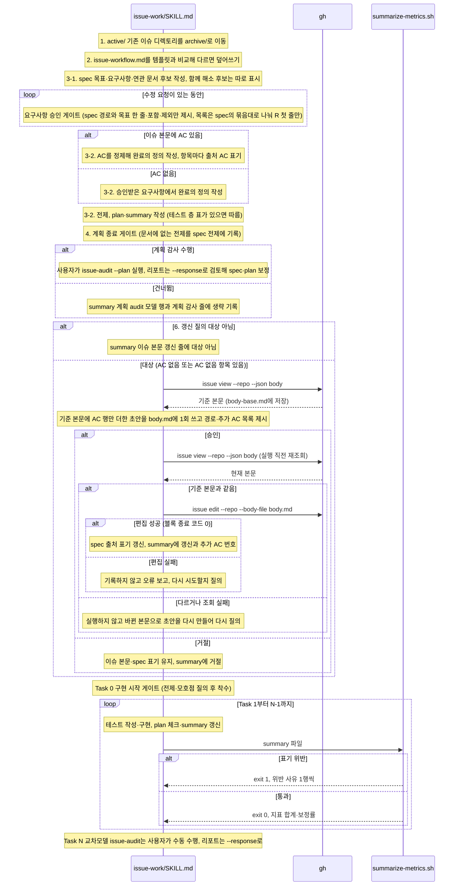

# issue-work 새 이슈 시작 호출 흐름

## What

이슈 단위로 spec·plan·summary를 만들고 Task를 진행한다. spec 요구사항은 사용자 승인 뒤에 완료의 정의·plan으로 이어지고, 이슈에 AC가 있으면 완료의 정의는 AC를 정제해 출처를 표기한다. 계획 종료 게이트 뒤에 계획 감사 수행 여부를 묻고, AC가 빠진 이슈는 Task 0 전에 이슈 본문 갱신을 묻는다. 마지막 Task N은 사용자가 교차모델 audit으로 직접 수행한다.

## How

```
issue-work/SKILL.md `## 새 이슈 시작 시` → `## 작업 진행 중`
├── 1. active/ 기존 이슈 → archive/ 이동
├── 2. templates/issue-workflow-template.md → active/issue-workflow.md   # 템플릿이 SSoT, 다르면 덮어쓰기
├── 3-1. 승인 전                        # templates/issue-spec-template.md 로 목표·요구사항(`### 포함`·`### 제외`, R 첫 줄 한 문장·세부 조건은 하위 목록, 각 5개 이상이면 `#### ` 묶음)·연관 문서 후보 (30_contract·40_domain·50_adr index)
│   ├── 함께 해소 후보                  # 70_ledger index 의 관련 active/ 항목을 따로 표시·질의, 포함하면 R 첫 줄 끝에 `(함께 해소: K-<번호>)`, 미포함은 기록 안 함
│   └── 요구사항 승인 게이트            # spec 경로 + 목표 한 줄·포함·제외 목록만 제시(목록은 spec의 묶음대로 나눠 R 첫 줄만), 이슈 본문 근거 없는 항목은 표시·질의
├── 3-2. 승인 후                        # 완료의 정의(`[D]`는 외부 경계의 인수 테스트)·전제(구현 전에도 통과가 정상인 항목은 본문 끝 `(회귀 방지 항목)`), templates/issue-plan-template.md·issue-summary-template.md
│   ├── 테스트 층 표                    # testing-principles-local.md 있으면 Task 테스트 [D]의 러너 호출·출력 판독·실행 셸과 DoD 인수 테스트 층을 층 표에서, 기기 확인 Task 없음
│   ├── AC 정제                         # 이슈 본문에 `- [ ] AC<n>: ` 행이 있으면 완료의 정의를 새로 쓰지 않고 AC를 [D]/[QD]/[ND]로 정제, 항목 끝 `(AC<n>)` 출처(회귀 방지 표시 앞), 모든 AC 연결(`공통` 회귀 방지 예외), AC 없는 R은 `(AC 없음: <사유>)`, 번호는 뒤에만 추가
│   └── 변경 통제                       # 정제 중 확장·완화로 분류한 변경은 질의·재승인 없이 spec에 반영하지 않음 (`## 작업 진행 중`)
├── 4. 계획 종료 게이트                 # 문서에 없는 전제를 spec `## 전제` 에 기록
├── 5. 계획 감사 질의                   # 기본값 없음. 수행: 사용자가 issue-audit --plan → --response / 건너뜀: summary `계획 audit 모델`·`계획 감사` 줄에 `생략`. 둘 다 6단계로
├── 6. 이슈 본문 갱신 질의              # 대상: 이슈 AC 없음 또는 spec에 `(AC 없음: …)` 항목. 아니면 summary `이슈 본문 갱신` 줄에 `대상 아님`
│   ├── 대상 저장소                     # --create 3단계 규칙, 값은 작은따옴표 인용, gh 없으면 MCP 폴백(github.com 한정)
│   ├── 기준 본문                       # 초안 직전 gh issue view --repo --json body > .ai/99_workspace/issue-<번호>-body-base.md, 조회 실패면 초안 안 씀
│   ├── 초안                            # 기준 본문 + AC 행만 추가 → .ai/99_workspace/issue-<번호>-body.md 1회, 대화엔 경로·추가 AC 목록만
│   ├── 실행 (승인 시만)                # 직전 재조회(mktemp) → cmp -s 기준 본문, 같을 때만 gh issue edit --repo --body-file, 다르거나 조회 실패면 미실행. 분기 결과를 rc로 받아 rm -f 뒤 블록 종료 코드로 반환, 편집 실패면 기록 없이 오류 보고·재시도 질의
│   └── 기록                            # 갱신 · <AC 번호>(spec 출처 표기 갱신) / 거절, 이후 Task 0
├── Task 0: 구현 시작 게이트            # summary `이슈 본문 갱신` 줄이 비어 있으면 6단계 먼저, 전제·모호점 질의 후 착수
├── 변경 통제 (`## 작업 진행 중`)       # 구체화: 질의 없이 반영 / 확장: 범위 확장(6단계 방식 본문 갱신+재승인)·원장 등재·새 이슈(--create) 중 선택 질의 / 완화: 재승인 없이 반영 안 함. 기준선은 이슈 AC, 없으면 3-1 승인 요구사항
├── Task 1..N-1                         # 그 Task 기능의 테스트 작성과 테스트 `[D]`를 Task 안에 둠, 완료 기준은 진행만 판정(spec에 없는 결과를 더하지 않음), 완료 시 plan 체크·summary 갱신
│   └── scripts/summarize-metrics.sh <summary>   # 수치 지표 3종(audit 발견·보정 반영·재시도) 표기 검사·보정률 집계, 위반은 exit 1
└── Task N: 교차모델 issue-audit         # 사용자 수동 (구현 AI 자동 실행·종료 금지), `최종 audit 모델` 행에 "벤더, 모델명 (모델 ID)"·effort, 리포트는 --response 로
```

### 시퀀스 다이어그램



## Why

- 게이트 2건(계획 종료·구현 시작)의 근거는 `## 새 이슈 시작 시` 인용문에 있다. 문서를 쓴 주체와 읽는 주체가 다를 수 있고 세션이 바뀌면 전제가 유실된다.
- 완료 기준을 `[D]`·`[QD]`·`[ND]`로 나누는 축은 [architecture.md 디자인 원칙](../../10_rules/architecture.md) `### 기존 체계와의 관계`에 있다. 레벨 정의·기본값 `[D]`·강등 사유 병기·접기 형식은 [ADR 0003](../../50_adr/active/0003-verification-levels-and-determinization.md). 계획·구현 테스트 관점 구분과 구현 테스트의 Task별 배치는 [ADR 0019](../../50_adr/active/0019-test-perspectives-and-task-level-placement.md). 테스트를 어느 층·러너·셸로 실행할지는 repo의 테스트 층 표가 정한다([ADR 0023](../../50_adr/active/0023-testing-principles-pair-and-consumer-skill-references.md)).
- 지표 5종(`수행 모델`·`수행 effort`와 수치 3종)을 값이 없어도 남기는 이유는 `## 작업 진행 중`(사후 집계가 표기 고정에 의존)에 있다.
- Task N을 사용자가 타벤더 모델로 직접 수행하는 원칙은 [ADR 0004](../../50_adr/active/0004-cross-model-audit-and-response-gate.md). 계획 종료·구현 시작 게이트와 `모델 기록` 표는 [ADR 0005](../../50_adr/active/0005-model-separation-gates.md). 요구사항 승인 게이트와 계획 감사 질의는 [ADR 0016](../../50_adr/active/0016-spec-requirements-layer-and-plan-audit.md). 함께 해소 후보와 해소 기재 시점은 [ADR 0018](../../50_adr/active/0018-ledger-proactive-review-and-resolve-timing.md).
- AC 정제·출처 표기, 6단계 이슈 본문 갱신 질의(계획 감사 뒤·Task 0 전), 변경 통제의 구체화·확장·완화 분류는 [ADR 0026](../../50_adr/active/0026-acceptance-criteria-across-issue-spec-pr.md). 이슈 본문 갱신은 외부 공개 행위라 [승인 게이트 정책](../../40_domain/policies/local/external-action-approval-gate.md)을 따르고, `gh` 인용·MCP 폴백 규칙은 [GitHub 연동 계약](../../30_contract/github-integration.md)을 따른다. 초안 파일을 승인 뒤 다시 대조하지 않는 구조는 원장 [K-0003](../../70_ledger/active/K-0003-approved-file-content-unverified.md)과 같다.
- 요구사항의 `### 포함`·`### 제외` 표지, R 첫 줄과 하위 목록, 5개 기준 묶음은 [ADR 0016](../../50_adr/active/0016-spec-requirements-layer-and-plan-audit.md)의 #140 일부 변경이다. 실제 spec의 묶음 여부를 헬퍼로 판정하지 않는 것은 원장 [K-0030](../../70_ledger/active/K-0030-spec-requirements-ungrouped-check-absent.md)으로 수용했다.
- 명세: [이슈 단위 작업 워크플로우 요건](../../40_domain/specs/issue-workflow.md)(절차 순서, AC 정제·이슈 본문 갱신 질의·변경 통제, spec·plan·summary 구성, 게이트 10종 요약).
- 헬퍼·테스트 배치는 [ADR 0001](../../50_adr/active/0001-skill-deterministic-helper-test-convention.md).
