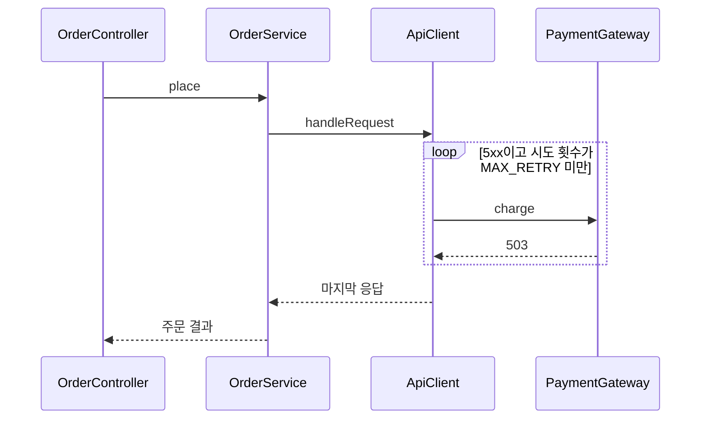

<!--
이 파일은 git-review-quiz 산출 파일 형식의 SSoT다.
작성 규칙은 `git-review-quiz/SKILL.md`, 형식 검사는 `git-review-quiz/scripts/check-quiz.sh`에 있다.
한쪽을 고치면 나머지 둘과 `git-review-quiz/tests/`의 기대값을 함께 갱신한다.

아래 예시 문항 두 개는 형식 견본이다. 실제 산출에서는 지우고 생성한 문항으로 바꾼다.
견본을 형식대로 유지해야 템플릿 자체가 check-quiz.sh 검사를 통과한다.

대화형 산출은 `## 대상` 다음에 설명 절 `## 배경`·`## 목적`·`## 변경 설명`을 이 순서로 두고 `## 문항`으로 이어 간다.
설명 절의 코드 블록 안에는 `## `·`### `로 시작하는 행을 두지 않는다.

`--comment` 게시 본문은 이 템플릿에서 설명 절 3개와 `## 응답 기록`을 빼고 **모든** 위치 행에 permalink 를 병기한 형태다.
그 본문은 `check-quiz.sh --comment --head <headRefOid> --base <baseRefOid>` 로 검사한다.
아래 견본은 Q1 에 permalink 가 없어 대화형 산출 형태이며, 일반 모드로만 검사한다.
-->

# 리뷰 퀴즈 PR #<번호> <제목>

## 대상

| 항목 | 값 |
|------|-----|
| 대상 | PR #<번호> <제목> (브랜치 모드면 `<브랜치명>` vs `<base 브랜치>`) |
| 기준 커밋 | `<head SHA>` (삭제 코드 문항은 base `<base SHA>` 기준) |
| 형식 | 객관식 (또는 주관식, 혼합) |
| 관점 | 테크·비즈니스 (또는 테크만, 비즈니스만) |
| 근거 문서 | `.ai/40_domain/policies/common/<문서>.md`, `.ai/30_contract/<문서>.md` (없으면 `없음 (테크 문항만)`) |
| 문항 수 | 5 |

## 배경

주문 API가 결제 대행사의 일시 장애(503)를 그대로 오류로 돌려줘, 장애가 잠깐만 이어져도 주문이 실패한다는 문의가 이어졌다. 변경 전에는 `handleRequest`가 요청을 한 번만 보내고 응답 상태 코드와 관계없이 결과를 그대로 반환했다.

<details>
<summary>입문용 심화 설명</summary>

5xx는 서버 쪽 일시 오류라 같은 요청을 다시 보내면 성공할 수 있다. 4xx는 요청 자체가 잘못된 것이라 다시 보내도 결과가 같다. 그래서 재시도는 5xx에만 걸고 횟수 상한을 둔다.

</details>

## 목적

일시 장애로 실패한 주문 요청을 정해진 횟수 안에서 다시 보내 성공시킨다.

- 결제 대행사 일시 장애에 따른 주문 실패 문의가 줄어든다.
- 4xx는 즉시 반환해 잘못된 요청을 반복하지 않는다.

## 변경 설명

### 변경 개요

| 묶음 | 위치 | 한 줄 요약 |
|------|------|-----------|
| 재시도 루프 | `src/api/handler.ts:88-104` | 5xx 응답에 `MAX_RETRY`회까지 다시 보낸다 |
| 할인율 상한 | `src/billing/discount.ts:42-58` | 신규 고객 첫 결제 할인 상한을 30%로 올린다 |

읽을 순서: 재시도 루프 → 할인율 상한

기타 변경: `README.md`, `src/api/types.ts`

### 호출 흐름

**`POST /orders`**

```
OrderController#create
└── OrderService#place
    └── ApiClient#handleRequest (변경)   # 5xx면 MAX_RETRY회까지 다시 보냄
        └── PaymentGateway#charge (외부 API)
```



### 재시도 루프

위치: `src/api/handler.ts:88-104`

**무엇이 바뀌었나**: 요청을 한 번만 보내던 `handleRequest`가 5xx 응답이면 `MAX_RETRY`회까지 다시 보낸다. 4xx는 다시 보내지 않고 바로 반환한다.

**전후 예시**

| 입력 | 변경 전 | 변경 후 |
|------|---------|---------|
| 503이 두 번 온 뒤 200 | 첫 503을 오류로 반환 | 세 번째 시도의 200을 반환 |
| 400 | 400을 반환 | 다시 보내지 않고 400을 반환 |

**핵심 코드 조각**

```ts
for (let attempt = 1; attempt <= MAX_RETRY; attempt++) {
  res = await send(req);
  if (res.ok || is4xx(res.status)) break;
}
```

### 할인율 상한

위치: `src/billing/discount.ts:42-58`

**무엇이 바뀌었나**: 신규 고객 첫 결제의 할인 상한 상수가 25에서 30으로 바뀌었다.

**전후 예시**

| 입력 | 변경 전 | 변경 후 |
|------|---------|---------|
| 신규 고객 첫 결제, 요청 할인율 35% | 25% 적용 | 30% 적용 |

## 문항

### Q1 [테크 · 객관식]

위치: `src/api/handler.ts:88-104`

`handleRequest`에 추가된 재시도 루프는 어떤 조건에서 재시도를 멈추는가?

- (a) 응답 상태 코드가 5xx가 아닐 때
- (b) 시도 횟수가 `MAX_RETRY`에 도달했거나 응답이 4xx일 때
- (c) 요청 타임아웃이 발생했을 때

<details>
<summary>힌트</summary>

루프를 빠져나오는 갈래가 둘이다. 한쪽은 시도 횟수를, 다른 한쪽은 응답 상태 코드의 범위를 본다.

</details>

<details>
<summary>정답·해설</summary>

(b). 루프는 `attempt >= MAX_RETRY`에서 빠져나오고, 4xx는 다시 보내도 결과가 같아 즉시 중단한다.

근거: `src/api/handler.ts:96-101`

</details>

### Q2 [비즈니스 · 주관식]

위치: `src/billing/discount.ts:42-58` ([permalink](https://github.com/<소유자>/<저장소>/blob/0123456789abcdef0123456789abcdef01234567/src/billing/discount.ts#L42-L58))

이번 변경으로 할인율 상한이 바뀌었다. 이 상한을 정하는 정책 조항은 무엇이고, 변경 후 값이 그 조항과 어떻게 맞는지 설명하라.

<details>
<summary>힌트</summary>

`.ai/40_domain/policies/` 아래 가격 정책 문서에서 상한을 정한 조항을 찾는다. 변경 전후 값을 그 조항의 숫자와 나란히 놓고 본다.

</details>

<details>
<summary>정답·해설</summary>

신규 고객 첫 결제에 한해 상한을 30%로 두는 조항이 근거다. 변경은 상한 상수를 25에서 30으로 올려 코드 값을 조항에 맞춘다.

근거: `src/billing/discount.ts:47`
정책 근거: `.ai/40_domain/policies/common/pricing.md` "신규 고객 첫 결제 할인은 30%를 넘지 않는다"

</details>

## 응답 기록

<!--
대화형 진행 전용 섹션이다. `--comment` 본문 파일에는 두지 않는다.
문항 하나를 마칠 때마다 한 행씩 덧붙인다. `판정`은 정답 / 부분 / 오답 중 하나이며,
정답이 아니면 괄호로 사유를 한 줄 붙인다.
-->

| 문항 | 응답 | 판정 |
|------|------|------|
| Q1 | (b) | 정답 |
| Q2 | 신규 고객 첫 결제에만 적용되는 상한이다 | 부분 (상한 값 30%를 짚지 않음) |
